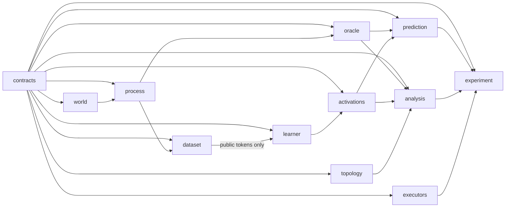

# topo-pilot: topology of a latent world in transformer representations

> **Status: exit level E0 reached** (2026-10-13). Implementation is in progress, wave by wave, following `ORCHESTRATOR_PROMPT.md`.

## Current finding (E0)

**The PH pipeline recovers the known topology: Vietoris–Rips on the intrinsic metric gives one long H₁ bar for the cylinder (S = 0.299) and none for the square (S = 0.037), even though their transition graphs have 133 and 121 independent cycles. Graph cycles are not surface holes.**

| world | graph cycle rank | β₁ (GF(2)) | S, flat d_M | S, graph metric (sensitivity) |
|---|---|---|---|---|
| square | 121 | 0 | 0.037 | 0.067 |
| cylinder | 133 | 1 | 0.299 | 0.231 |

Gate G-A passed with thresholds fixed before the run (D-016). In the synthetic calibration (M = 512 in ℝ¹²⁸), a noisy circle was ranked above every disk in 20/20 draws. Figure and details: [`reports/E0/summary.md`](reports/E0/summary.md). To regenerate: `topo-pilot report --level E0` (Windows: `.	asks.ps1 reproduce-figures`).

This finding involves no model. **Not run yet:** S2 (σ calibration, discriminability of the unlearned spaces, preregistration), S3–S8 (training, F1, controls, dynamics, sensitivity). No claim is made about learned representations.

## Reproduce (Windows, CPU)

```powershell
python -m venv .venv; .\.venv\Scripts\python.exe -m pip install -r requirements.lock -e .
.\.venv\Scripts	opo-pilot.exe stage S0   # environment and contract sanity
.\.venv\Scripts	opo-pilot.exe stage S1   # worlds, kernels, emissions, PH calibration (~30 s)
.\.venv\Scripts	opo-pilot.exe report --level E0
```

## The question, in one paragraph

Train a small causal transformer from scratch to predict the next symbol of sequences emitted by a hidden random walk on a world whose topology is known: a **cylinder** versus a **square**. The two worlds have the same number of states, the same emission statistics, and the same dynamics rule. The **single finding** (F1) the project is built around: does training increase a persistent H₁ signal in the residual stream that distinguishes the cylinder from the square, beyond initialisation and consistently across seeds and sample panels?

Three ingredients make the answer interpretable:
- an exact Bayesian oracle;
- matched controls: an emission whose spatial smoothness is permuted away, and an emission that carries no information;
- representation baselines for known pitfalls: symbol mixing, per-state centroids, and the Gaussian noise floor.

The answer is interpretable **whether it is positive or negative**.

## How to use this package

1. Unzip, and open the folder as the working directory of a capable coding agent (the "conductor").
2. Give it `ORCHESTRATOR_PROMPT.md` as its instructions.
3. The conductor:
   - builds the modules wave by wave, with cheaper sub-agents working in parallel;
   - verifies each module in isolation;
   - runs the stages;
   - stops at four human checkpoints (H1–H4) for your approval.
4. You can stop after any stage and still have a working, reportable result (exit points E0–E4).

## Map

| Path | What it is |
|---|---|
| `ORCHESTRATOR_PROMPT.md` | the master prompt for the conductor model |
| `docs/RESEARCH_SUMMARY.md` | binding research decisions (English) |
| `docs/RESEARCH_PLAN_HE.md` | the full plan with rationale and literature (Hebrew) |
| `docs/STAGES.md` | build waves, run stages S0–S8, gates, exit points, budgets, cut paths |
| `docs/CONVENTIONS.md` | OOP, docs, tests, and logging rules |
| `docs/DATA_SCHEMAS.md` | every artifact, field, shape, and access rule |
| `docs/EXECUTION.md` | local vs external execution (bundles for any GPU machine; no cloud-drive dependency) |
| `docs/HANDOFF.md` | how another model or person resumes the work |
| `docs/EXTENSIONS.md` | X1 orientability, X2 unions of tori, X3 higher-dimensional holes |
| `agents/` | brief templates, report format, review checklist |
| `src/topo_pilot/<module>/SPEC.md` | the contract of each of the 12 modules |
| `tests/<module>/TEST_PLAN.md` | the separate test plan of each module; `tests/integration/` runs at gates only |
| `configs/` | `base.yaml` (closed decisions), `stages.yaml`, `extensions/` |
| `state/` | `PROGRESS.md` (overwritten), `DECISIONS.md` (append-only) |
| `tools/SPEC.md` | repository checks: affected tests, import and leakage rules, file sizes, state hygiene |

## Modules and dependencies


