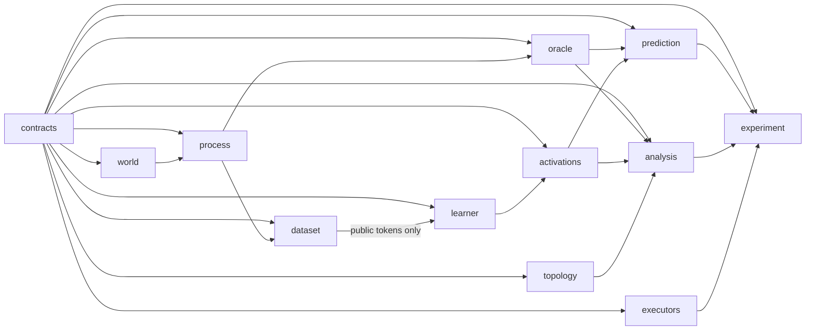

# topo-pilot: topology of a latent world in transformer representations

> **Status: exit level E2 reached** (2026-10-13): 7 models trained on CPU under condition O (3 replicates × cylinder/square, plus the N control); F1 decided by the rule fixed in [`PREREGISTRATION.md`](PREREGISTRATION.md) before any training; secondary analyses X4 pre-registered blind in [`PREREGISTRATION_X4.md`](PREREGISTRATION_X4.md). Implementation continues wave by wave following `ORCHESTRATOR_PROMPT.md`.

## Current finding (E2)

**Under the smooth emission O, next-token training increases a persistent H₁ signal in the final residual stream that distinguishes the cylinder from the square (F1 supported: D > 0 in 8/8 panels in each of 3 replicates, median D 0.158–0.176 above the noise envelope u_r 0.084–0.097, all learning gates passed), and the activation geometry follows the 32-symbol belief more than the last-symbol posterior, including among histories that share the last symbol (H2: Δgeom > 0 in 48/48 panels).**

**Caveat (R1).** The trained embedding of the last symbol alone (baseline R1) already reproduces a substantial fraction of the cylinder–square contrast: its median D is 0.89, 0.47 and 0.54 of the model's in the three replicates (the mixing baselines R2 and R3 stay at ≤ 0.20). F1 alone therefore does not establish that history integration causes the topological signal; under O, the emission geometry learned into the symbol embeddings may carry much of it. The axis-permuted control P (stage S5, H3/H3′) remains essential. H2 points to history use beyond the last symbol: within pairs that share it, where R1 is constant, the activation distances track the 32-symbol belief (ρ_s 0.935–0.979 per run) and beat R2 and R3 in every panel.

**Readout split (secondary, X4).** The F1 rule also passes on the readout-null part V4 of the LayerNorm-normalised activations (the directions the unembedding cannot see), as well as on the readout-visible part V3, the normalised stream, and the model's predictive distributions. This shows that the structure is present in those subspaces; it does not show that it is functionally necessary for prediction, which would need interventions.

| replicate | S cyl init | S cyl final | S sq init | S sq final | panels D > 0 | median D | u_r |
|---|---|---|---|---|---|---|---|
| 1729 | 0.058 | 0.307 | 0.062 | 0.129 | 8/8 | 0.158 | 0.097 |
| 2718 | 0.057 | 0.321 | 0.058 | 0.137 | 8/8 | 0.176 | 0.084 |
| 3141 | 0.058 | 0.304 | 0.059 | 0.126 | 8/8 | 0.173 | 0.084 |

Median S over 8 panels of 512 test histories each, primary hook `resid_post_3`, raw Euclidean distances, VR over GF(2); init = checkpoint 0, final = step 5000. Full tables (prediction vs oracle, baselines R1–R3, Δgeom, Gaussian floor, H0, G-F, and X4 with its interpretation caveats): [`reports/E2/summary.md`](reports/E2/summary.md). Observations made after unblinding are kept separate in [`reports/E2/exploratory.md`](reports/E2/exploratory.md).

### Earlier exit (E1, no model)

**With no model involved, the exact Bayesian belief and prediction spaces already separate the cylinder from the square under the smooth emission O (S_cyl > S_sq in 8/8 panels in every space; belief b³² median S 0.671 vs 0.321, Gaussian floor ≤ 0.10), while under the axis-permuted control P the belief space no longer separates them (5/8 panels).**

Median S over 8 panels of 512 histories each (Hellinger distances, VR over GF(2)); replicate 1729, σ = 1.25:

| space | O: cylinder vs square (panels cyl > sq) | P: cylinder vs square (panels cyl > sq) |
|---|---|---|
| belief b³² (exact filter) | 0.671 vs 0.321 (8/8) | 0.323 vs 0.310 (5/8) |
| last-symbol posterior b¹ | 0.324 vs 0.165 (8/8) | 0.324 vs 0.165 (8/8) |
| next-symbol future F₁ | 0.556 vs 0.189 (8/8) | 0.194 vs 0.241 (1/8) |
| two-symbol future F₂ | 0.614 vs 0.216 (8/8) | 0.202 vs 0.242 (2/8) |
| emission field (144 states) | 0.568 vs 0.108 | 0.568 vs 0.108 |

The rows for b¹ and the emission field are identical under O and P. P permutes the states, which leaves both point clouds unchanged up to relabelling. Consequence, pre-registered: H3 (structure under P) can only be decided in one direction. A failure under P is expected even for the ideal predictor.

### Earlier exit (E0, no model)

The PH pipeline recovers the known topology. Vietoris–Rips on the intrinsic metric gives one long H₁ bar for the cylinder (S = 0.299) and none for the square (S = 0.037), even though their transition graphs have 133 and 121 independent cycles. Graph cycles are not surface holes. Gate G-A passed with thresholds fixed in advance (D-016). Details: [`reports/E0/summary.md`](reports/E0/summary.md).

**Not run yet:** S5 (condition P: H3, H3′), S6 (dynamics: H4; layer sweep), S7 (U and extra N controls, probes, sensitivity, circular coordinates), S8 (clean rerun). No claim is made about P, H3, H4, or causal use of the structure.

## Reproduce (Windows, CPU)

```powershell
python -m venv .venv; .\.venv\Scripts\python.exe -m pip install --extra-index-url https://download.pytorch.org/whl/cpu -r requirements.lock -e .
.\.venv\Scripts\topo-pilot.exe stage S0   # environment and contract sanity
.\.venv\Scripts\topo-pilot.exe stage S1   # worlds, kernels, emissions, PH calibration (~30 s)
.\.venv\Scripts\topo-pilot.exe stage S2   # data, exact oracle, baselines, σ, discriminability (~5 min)
.\.venv\Scripts\topo-pilot.exe prereg     # regenerates the S2 tables in PREREGISTRATION.md
.\.venv\Scripts\topo-pilot.exe report --level E0
.\.venv\Scripts\topo-pilot.exe stage S3   # smoke run + throughput (G-E)
.\.venv\Scripts\topo-pilot.exe stage S4   # 7 training runs on CPU (~1.6 h) + F1 analysis (G-F)
.\.venv\Scripts\topo-pilot.exe stage X4   # secondary readout-geometry analyses (~2 min)
.\.venv\Scripts\topo-pilot.exe report --level E2
```

## The question, in one paragraph

Train a small causal transformer from scratch to predict the next symbol of sequences emitted by a hidden random walk on a world whose topology is known: a **cylinder** versus a **square**. The two worlds have the same number of states, the same emission statistics, and the same dynamics rule. The **single finding** (F1) the project is built around: does training increase a persistent H₁ signal in the residual stream that distinguishes the cylinder from the square, beyond initialisation and consistently across seeds and sample panels?

Three ingredients make the answer interpretable:
- an exact Bayesian oracle;
- matched controls: an emission whose spatial smoothness is permuted away, and an emission that carries no information;
- representation baselines for known pitfalls: symbol mixing, per-state centroids, and the Gaussian noise floor.

The answer is interpretable **whether it is positive or negative**.

## How to use this package

1. Unzip, and open the folder as the working directory of a capable coding agent (the "conductor").
2. Give it `ORCHESTRATOR_PROMPT.md` as its instructions.
3. The conductor:
   - builds the modules wave by wave, with cheaper sub-agents working in parallel;
   - verifies each module in isolation;
   - runs the stages;
   - stops at four human checkpoints (H1–H4) for your approval.
4. You can stop after any stage and still have a working, reportable result (exit points E0–E4).

## Map

| Path | What it is |
|---|---|
| `ORCHESTRATOR_PROMPT.md` | the master prompt for the conductor model |
| `docs/RESEARCH_SUMMARY.md` | binding research decisions (English) |
| `docs/RESEARCH_PLAN_HE.md` | the full plan with rationale and literature (Hebrew) |
| `docs/STAGES.md` | build waves, run stages S0–S8, gates, exit points, budgets, cut paths |
| `docs/CONVENTIONS.md` | OOP, docs, tests, and logging rules |
| `docs/DATA_SCHEMAS.md` | every artifact, field, shape, and access rule |
| `docs/EXECUTION.md` | local vs external execution (bundles for any GPU machine; no cloud-drive dependency) |
| `docs/HANDOFF.md` | how another model or person resumes the work |
| `docs/EXTENSIONS.md` | X1 orientability, X2 unions of tori, X3 higher-dimensional holes |
| `agents/` | brief templates, report format, review checklist |
| `src/topo_pilot/<module>/SPEC.md` | the contract of each of the 12 modules |
| `tests/<module>/TEST_PLAN.md` | the separate test plan of each module; `tests/integration/` runs at gates only |
| `configs/` | `base.yaml` (closed decisions), `stages.yaml`, `extensions/` |
| `state/` | `PROGRESS.md` (overwritten), `DECISIONS.md` (append-only) |
| `tools/SPEC.md` | repository checks: affected tests, import and leakage rules, file sizes, state hygiene |

## Modules and dependencies


