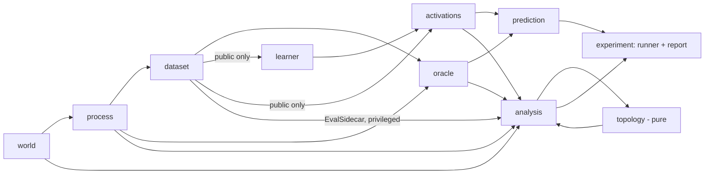
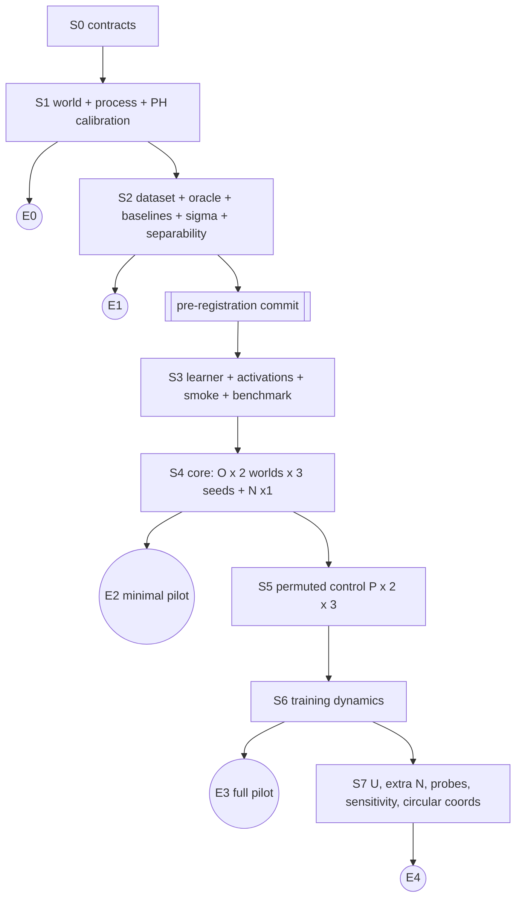

English translation of docs/RESEARCH_PLAN_HE.md at commit 727af56 (job 0068). The Hebrew original is authoritative.

# Topology of a latent world in Transformer representations: a unified, staged pilot plan

> **Status:** planning only. Version 2.0, 2026-10-12. No code has been written, no dependencies installed and nothing run.
> **Sources:** a merge of three drafts: `he` (called A), `he2` (called B) and `PILOT_DESIGN.md` (called C).
> **Structural principle:** building and running are divided into stages. Each stage ends at an **exit point** that produces a valid, presentable product, even if the work stops there.

---

## 0. Summary

We will create two synthetic worlds of size $12\times12$ states: a **square** ($\beta_1=0$) and a **cylinder** ($\beta_1=1$). In both, a lazy, local random walk takes place. Each state emits an arbitrary symbol out of 36 symbols, according to an overlapping emission field. We will train a small causal Transformer from scratch to predict the next symbol, and it will see the symbols only. We will analyse the residual stream with persistent homology (PH) and compare it with four reference spaces: the world, the emission field, the belief states of an exact Bayesian predictor, and the future distributions.

**The single finding being aimed at (F1):** whether training increases a persistent H₁ signal in the final residual stream, a signal that distinguishes the cylinder from the square beyond what exists at initialisation. This contrast is defined in advance, and it is required to be consistent across three replicates and across all sample panels.

All other analyses are meant to interpret F1, and are not separate findings:
- whether the geometry tracks the belief built from the history, or only the last symbol;
- whether the signal survives when the emissions are shuffled;
- when the signal appears during training.

**What is taken from each draft:**
- **From B:** the skeleton, the worlds, the emission field, the validity gates, PH on raw activations, the measure $S$ and the contrast against initialisation.
- **From A:** the comparison between a belief from 32 symbols and a belief from one symbol, disjoint sample panels as a noise envelope, a cut path defined in advance, and the note on an HMM that emits from states versus an HMM that emits from arcs.
- **From C:** a matched shuffled-emission control, checkpoints on a logarithmic schedule, a strict threshold for the usefulness of context, an observability matrix, and the closest literature.

**Corrections to defects found in the comparison between the drafts:**
- The negative control is no longer used to calibrate a threshold. In C this created circularity.
- There is no bottleneck comparison between diagrams computed in different metrics (A).
- The 16×4 strip world was replaced, because half of its states sit on the boundary (A).
- Duplicate negative runs were avoided.

---

## 1. Question, hypotheses and basic distinctions

### 1.1 Question

When training to predict the next symbol on sequences from a world of known topology, does a structure that reflects the world's topology form in the context-dependent representation? And if so, does it stem from the geometry of the observations, from the belief built from the history, or only from what is needed for prediction?

### 1.2 Falsifiable hypotheses

| # | Hypothesis | Measure | Falsification or limitation |
|---|---|---|---|
| **H1 (primary)** | Training increases an H₁ signal that distinguishes cylinder from square | $D_r$ (§7.3), in every replicate $r$ and in each of eight sample panels | $D_r\le0$ in one of the replicates or in more than one panel; or the signal exists to the same extent at initialisation; or it disappears under an alternative metric or sampling |
| H2 (the addition of history) | The geometry of the activations is closer to the beliefs after 32 symbols than to the belief from the last symbol alone | $\Delta_\text{geom}$, also within pairs with the same last symbol (§7.4) | $\Delta_\text{geom}\le0$, or the result disappears when conditioning on the last symbol |
| H3 (what learning adds) | Under shuffled emissions (P, §3.3) still $D_r>0$, i.e. the structure is learned from the dynamics and not only from the emission field | $D_r$ and $\Delta_\text{geom}$ in condition P | If $D_r\le0$ in P although the model passed the learning gate, the signal in O stems from the geometry of E |
| H4 (timing) | $S$ rises only after the model starts using the history, i.e. after the regret drops below $G_C$ (§6.3) | Curves of $S$ and regret over 12 checkpoints. The concentration of the change in $S$ in time is tested against a null that shuffles the order of the checkpoints (as in Malhotra et al.) | If $S$ rises before history use, the structure stems from symbol statistics alone |
| H0 (negative) | With identical emissions nothing can be learned about the hidden state | The belief is constant; NLL ≥ $H(W)$ | If NLL is lower than $H(W)$ beyond the confidence range, there is leakage or a bug |

### 1.3 Detection ≠ use ≠ necessity

The pilot can **detect** structure and measure its correlation with prediction. It cannot show that the model **uses** the structure, because that requires an intervention on the activations, and that is an extension. Nor can it show that the structure is **necessary** for prediction. The future spaces $F_1, F_2$ show only which distinctions are needed for prediction up to horizon 2. There is no assumption here that natural language, activations or beliefs are manifolds. The homology of a Rips complex is a property of data and a metric at a given scale, and does not prove a homeomorphism.

---

## 2. Exit points: what you get at each stop

| Exit | After stage | What works and is shown | What may be claimed | Training runs |
|---|---|---|---|---|
| **E0** | S1 | World, complex, dynamics and emissions, and PH calibration on known ground truth | "The PH pipeline detects the cylinder and distinguishes graph cycles from surface holes" | 0 |
| **E1** | S2 | Data, exact predictor, comparison baselines, and a table of topological distinction between the spaces | "Which topological differences exist in principle between the world, the emissions, the beliefs and the futures", without a model | 0 |
| **E2** (minimal pilot) | S4 | Central experiment: 2 worlds × 3 seeds + negative | The F1 result (positive, negative or inconclusive) and H2 | 7 |
| **E3** (full pilot) | S5 + S6 | Shuffled-emission control and training dynamics | H3 and H4 | 13 |
| **E4** (extended pilot) | S7 | Unique-symbol control, an additional negative, probes, full sensitivity and circular coordinates | Strengthening of the interpretation | 17 |

**Rule:** every exit produces a README with the finding within its limits. Stages that were not performed are explicitly marked "not performed", and are not omitted.

---

## 3. The data-generating process

### 3.1 Worlds (closed decision)

A $12\times12$ lattice with spacing 1 and 4-neighbourhood. There are $N=144$ states with dense identifiers 0..143. The identifiers are arbitrary, and the coordinates are available only to the generator and the analysis.

| World | Gluing | $V$ | $E$ | $F$ | $\chi$ | $\beta$ over $\mathbb{F}_2$ | Graph cycles $E-V+1$ |
|---|---|---|---|---|---|---|---|
| Square | none | 144 | 264 | 121 | 1 | (1,0,0) | 121 |
| Cylinder | periodic x axis | 144 | 276 | 132 | 0 | (1,1,0) | 133 |

- **The graph is not the surface.** Even in the square the graph has 121 cycles, one around each face. In the complex these faces are filled, so they are not holes. $\beta$ is computed from the ranks of the boundary matrices $\partial_1,\partial_2$ over $\mathbb{F}_2$, and it is checked that $\partial_1\partial_2=0$.
- **Primary metric:** flat intrinsic distance. In the square $d_M=\sqrt{\Delta x^2+\Delta y^2}$. In the cylinder $d_M=\sqrt{\min(|\Delta x|,12-|\Delta x|)^2+\Delta y^2}$. **Sensitivity metric:** graph distance. **Torus** ($\beta=(1,2,1)$) **and Möbius** are extensions. Möbius and cylinder are homotopy equivalent, so $\beta$ alone does not distinguish them.

### 3.2 Dynamics

$p_\text{stay}=0.2$, and 0.2 for each of the four directions. An attempt to cross the boundary becomes staying in place. In the cylinder, the move across the seam is periodic. $T[i,j]=P(z_{t+1}=j\mid z_t=i)$ is symmetric and doubly stochastic, so $\pi$ is uniform. There are self-loops, so the chain is aperiodic. There are no observed actions.

**Differences that remain between the worlds** (measured and reported): the staying rate in boundary states, the diameter, the spectral gap, the mixing time, and the normalisation of the emissions near the boundary. This is a comparison between **two processes**, not an intervention on the topology alone.

### 3.3 Symbol assignment: alternatives and choice

| Alternative | What is tested | Status |
|---|---|---|
| Overlapping: Gaussians around centres | Continuous uncertainty and its reduction using history | **O: central experiment** (S4) |
| **Shuffled by axes (matched):** $E_P[(x,y),\cdot]=E_O[(\sigma_x(x),\sigma_y(y)),\cdot]$, with two fixed random permutations: one for the columns and one for the rows of the lattice | Learning from the dynamics when there is no observational smoothness. Same $V$, same set of rows, hence the same $H(W\mid Z)$. $p(w)=\pi E$ is identical because $\pi$ is uniform. **In addition, the factorisation of E is preserved** (see below) | **P: matched control** (S5) |
| Fully shuffled: $E=\Pi E_O$ with a general permutation of the 144 states | Like P, but also breaks the factorisation | Extension |
| Identical in all states | Leakage and false-positive rate | **N: negative** (S4 and S7) |
| A unique symbol for each state | Learning dynamics when the state is visible, $V=144$ | **U: sanity control** (S7) |
| A symbol per region; by some of the features; random centres versus FPS | aliasing, deliberate information erasure, coverage | Extensions |

**Details of O:** $V=36$ centres on a fixed $6\times6$ grid, $c_{ab}=(0.5+2a,\ 0.5+2b)$ for $a,b\in\{0..5\}$. The centres are not states. The definition:
$$E_{zj}=\frac{\exp[-d_M(z,c_j)^2/2\sigma^2]}{\sum_k\exp[-d_M(z,c_k)^2/2\sigma^2]}.$$
In the cylinder the centres cover the circumference uniformly: 6 centres at spacing 2 on a circumference of 12. The symbol names undergo an arbitrary permutation, and it is saved.

**Factorisation of O (found in the literature review):** both the numerator of E and its denominator factor into a product, so $E_O[(x,y),(a,b)]=E^x[x,a]\,E^y[y,b]$ exactly. That is, each symbol is a pair of noisy readings, one per axis. The dynamics also almost factorises: at each step only one axis moves. According to Shai et al. 2026 ("Transformers learn factored representations"), models tend to represent nearly independent factors in orthogonal subspaces. Therefore the cylinder's cycle is expected to sit in the x-axis subspace. A general permutation of the states would break both the smoothness and the factorisation, and would confound the two effects. **P is defined as a per-axis permutation in order to break only the smoothness.** A difference that remains between the conditions: in P the product is preserved, but the neighbourhood in each axis is destroyed.

**Note on control U:** there $V\ne36$, so raw NLL is not comparable. Its belief cloud is the vertices of the simplex, and in Hellinger distance all vertices are equidistant from one another. Therefore we **do not expect** to see the cylinder in it. U is not a positive control for PH. The positive control is the world itself with $d_M$.

### 3.4 Calibration of σ (before any training, from the generator only)

The candidates are tested in this order: $\sigma\in(1.25,\ 0.75,\ 2.0)$. The first that meets all three conditions **in both worlds** is chosen:
1. The mean entropy of $b^{(1)}$ (belief from a single symbol) is at least $\log 2$, so the state is not almost visible.
2. $G_C=\overline{\mathrm{KL}}(q_C\,\|\,q_\text{last})\ge 0.10$ nats, so the history has real value. The threshold is stricter than B's (0.02).
3. For every symbol $p(w)\ge 0.5/V$.

**Fallback path:** if no candidate meets all the conditions, the candidate with the highest $\min_\text{world} G_C$ is chosen, provided it is at least 0.03 nats. In such a case the pilot is marked "weak context usefulness" in the preregistration. If this too does not hold, stop and correct the design, without an automatic sweep. All candidates are reported.

---

## 4. Sequence conventions and the exact predictor

### 4.1 Emission–transition order, window and masks

```text
z_1 ~ pi ; for t = 1..33: emit w_t ~ E[z_t,:] ; if t < 33: z_{t+1} ~ T[z_t,:]
model input  = [BOS, w_1, ..., w_32]   (33 positions, p = 0..32)
model target = [w_1, ..., w_33]
position p sees history w_{1:p} (p symbols) and predicts w_{p+1}
primary analysis position: p = 32 (one history per trajectory)
```

- The mask is causal. No packing, no padding, and no KV-cache shared between sequences. BOS is an input identifier only, and is not a target.
- **Comparison with an exact predictor:** every window starts from $\pi$, and this is exactly the information the model has. The HMM here emits **from states**. In Shai et al. the HMM emits from arcs, so formulas must be compared carefully.

### 4.2 Bayesian filtering (vectors are rows)

$$a_1=\pi,\quad b_t=\frac{a_t\odot E_{:,w_t}}{a_tE_{:,w_t}},\quad a_{t+1}=b_tT,\quad q_t=b_tTE,\quad q_0=\pi E.$$

- **Canonical belief at position $p$:** $b_p=P(z_p\mid w_{1:p})$. The predictive distribution is $q_p$.
- **Single-symbol baseline:** $r_w=\pi\odot E_{:,w}/(\pi E_{:,w})$ and $q_\text{last}=r_{w_p}TE$. They make it possible to ask what the history adds, without exposing $z$. Below, $b^{(1)}\equiv r_{w_{32}}$ and $b^{(32)}\equiv b_{32}$.
- **Computation:** float64, with normalisation at every step. If the evidence equals 0, `IMPOSSIBLE_HISTORY` is raised, without silent correction by an epsilon.
- **Mapping to the literature:** Shai et al. and Piotrowski et al. work with an HMM that emits from arcs, $T^{(x)}_{ij}=\Pr(x,s_j\mid s_i)$. In our "emit then transition" order, $T^{(x)}=\mathrm{diag}(E_{:,x})\,T$ holds. Therefore their belief $\eta$ after a symbol equals our $a_{p+1}=b_pT$, and not $b_p$. The two beliefs are related by a fixed linear map. In comparisons with their results $a_{p+1}$ is used.

### 4.3 Futures and observability

$F_1=b\,TE\in\Delta^{35}$. $F_2[i,j]=b\,T\,\mathrm{diag}(E_{:,i})\,T\,E_{:,j}\in\Delta^{1295}$, i.e. the joint distribution of the next two symbols, and not a product of marginal distributions.

**The observability matrix** $O_k=[TE;\ T\,\mathrm{diag}(E_{:,\cdot})TE;\dots]$ is checked through its rank and its singular values for $k\le3$. Belief directions that lie in its kernel are not needed for prediction up to horizon $k$. When $N>V$, the map $b\mapsto bTE$ is not injective on the whole simplex. Nevertheless, one must check **in the actual data** whether there are history pairs that are close in $F_1$ and far in $F_2$. If there are no such pairs, no claim is made that the model represents information beyond the next symbol.

---

## 5. Five definitions of proximity and comparison spaces

| Space | Points | Primary metric | Rationale | Sensitivity |
|---|---|---|---|---|
| World | 144 states | intrinsic $d_M$ | The geometry the generator assumes. The ground truth is measured on the complex, and VR on $d_M$ is used for calibration | graph distance |
| Emission field | 144 rows of $E$ | Hellinger $=\|\sqrt p-\sqrt q\|_2/\sqrt2$ | A true and bounded metric, which attaches no meaning to the symbol numbers | $\sqrt{\mathrm{JSD}}$ |
| Beliefs | $b^{(32)}$ and $b^{(1)}$ on the **same** histories | Hellinger | **Does not** use $d_M$, so structure found in it was not inserted from outside | $\sqrt{\mathrm{JSD}}$. $W_1$ with $d_M$ only as a labelled sensitivity, because it inserts the world's geometry |
| Futures | $F_1,F_2$ on the same histories | Hellinger | Distinctions needed for prediction up to horizon 2. This is an additional lens, not a new world | $\sqrt{\mathrm{JSD}}$ |
| Activations | `resid_post_3` before the final LN, $\mathbb{R}^{128}$ | **raw** Euclidean, no PCA | The geometry that training created, without result-directed processing | chord on normalised vectors; PCA-32 (fitted on dev); $M=256$ |

- **What is not done:** 1−cos is not a metric, so chord is used. No k-NN-based geodesic distance, because the choice of $k$ creates or erases connectivity. No UMAP or t-SNE as a basis for a conclusion. No averages by $z$ in the primary analysis, because sorting by the true state inserts the world's structure from outside.
- **Prediction equivalence:** $d_F=0$ means equivalence only up to horizon 2. This is a pseudometric, and identical points are merged with a saved identifier map.

---

## 6. Model, training, baselines and prediction measures

### 6.1 Model (B and C)

decoder-only with pre-LN: 4 blocks, $d=128$, 4 heads, $d_\text{mlp}=512$, GELU, learned positional embedding, final LN, untied unembedding, dropout=0. The input vocabulary is $V+1$ (with BOS) and the output vocabulary $V$. About 0.8M parameters.

**Hook points:** `embed`, `resid_post_0..3`, `ln_final_out`.

### 6.2 Training

- AdamW with lr=1e-3, warmup of 200 steps, cosine to 5,000 steps, wd=0.1, clip=1.0, batch=128 windows of 33 positions. In total about 21M targets per run. This is 5 times B and less than a third of C.
- **It is not assumed that there is a GPU.** By estimate, one run on an ordinary CPU takes 15–45 minutes, and on a GPU a few minutes. **This is an assumption that is measured at stage S3**, and according to the result the choice is made between running locally on the CPU and an external GPU (§10).
- **Data per replicate:** 131,072 train trajectories (about 4.3M tokens, uint8), 4,096 dev and 4,096 test. All are independent and start from $\pi$.
- **Checkpoints on a logarithmic schedule, always saved:** 0, 50, 100, 200, 400, 700, 1000, 1500, 2000, 3000, 4000, 5000.
- **The primary analysis is at step 5000**, without choosing the "prettiest" checkpoint.

### 6.3 Baselines and measures

- **Prediction baselines:** unigram and bigram from train with smoothing chosen on dev; $q_\text{last}$; $q_C$ (the exact predictor).
- **Representation baselines** (they pass through exactly the same PH and geom pipeline):
  - **(R0)** the model's activations before training;
  - **(R1)** the embedding of the last symbol in the trained model;
  - **(R2) mixing with the previous symbol:** $x(h)=\tfrac12[\phi(w_{32})+\phi(w_{31})]$, where $\phi$ is a spectral embedding of the symbol-to-symbol transition matrix, $E^\top\mathrm{diag}(\pi)TE$, with 8–16 components, without a model. Park et al. show that PCA of per-node averages equals the components of the spectral embedding when the Dirichlet energy is minimal. The LessWrong analysis shows that one step of mixing between neighbours suffices to create a lattice structure even from random vectors;
  - **(R3) average over the whole context:** $x(h)=\tfrac1{32}\sum_t\phi(w_t)$. This is what nearly uniform attention computes, and this is how the mechanism was described by Brenner et al.
- R2 and R3 test whether the signal is explained by a simple computation that does not require Bayesian filtering. In condition P, the graph between the symbols is shuffled, so R2 and R3 are expected to lose the structure. Exactly this makes P the right control.
- **regret** $=\overline{\mathrm{KL}}(q_C\,\|\,p_\text{model})$, computed exactly for each history. It is the primary measure, and NLL is reported beside it.
- **Learning gate:** $\text{captured}=1-\text{regret}/G_C\ge0.8$. If the model does not pass the gate, an absence of structure means "the model did not learn", not a negative finding.
- **Uncertainty:** bootstrap over trajectories. The 3 replicates are each shown separately, without a p-value over tokens.

---

## 7. PH protocol and decision

### 7.1 Sampling

Eight **disjoint panels** of 512 test trajectories. From each trajectory one history is taken, at position 32. The panels are fixed in advance by an analysis seed, and are shared by all layers, checkpoints and spaces. Panel 1 is used for the training curves, and all eight panels are used at steps 0 and 5000.

### 7.2 Filtration

- **Vietoris–Rips** over $\mathbb{F}_2$, dimensions 0 and 1, with a threshold that closes all H₁ bars. A bar cut before its death is marked `censored`.
- **Scale:** $s$ is the 95th percentile of the positive distances. Both the raw distances and $s$ are saved.
- **Constant cloud:** marked `collapsed`, and gets $S=0$. This is a valid state and not an exception.

### 7.3 Primary measure and F1

$$S=\max_{(u,v)\in D_1,\ v<\infty}\frac{v-u}{s},\qquad S=0\ \text{if there is no H₁}.$$

[translator's note: the Hebrew original has the formula text "אם אין H₁" inside `\text{}`; it is rendered here as "if there is no H₁".]

For every replicate $r$ and every panel $i$, where in the cylinder and the square **the same panel index is paired**:

$$D_{r,i}=(S^{\text{cyl}}_{\text{final},i}-S^{\text{cyl}}_{\text{init},i})-(S^{\text{sq}}_{\text{final},i}-S^{\text{sq}}_{\text{init},i}).$$

**F1 is supported** if three conditions hold:
1. $D_{r,i}>0$ in at least 7 of 8 panels, in each of the three replicates.
2. The median of $D_{r,\cdot}$ is greater than $u_r$, the 95th percentile of $|S_i-S_j|$ between panels within the same run. $u_r$ is the sampling-noise envelope, as in A.
3. All models passed the learning gate.

**F1 is rejected** if the sign is reversed or inconsistent, provided the validity gates passed. **The result is inconclusive** if any gate failed.

The four values of $S$ are always shown beside $D$, so that $D$ does not hide the source of the difference. A high $S$ **is not** $\beta_1=1$. The secondary measure $\pi_\text{max}=\text{death}/\text{birth}$ is also saved.

**Noise floor:** for every cloud, $S$ is also computed for two Gaussian clouds of the same $M$ and the same dimension: one isotropic and one with matched covariance, 20 samples each. They are not used as a decision threshold, but as context for understanding the size of the signal. Malhotra et al. report that an isotropic Gaussian cloud of the size and dimension of such clouds produces about 238 spurious H₁ bars. Therefore bars must not be counted without such a reference.

### 7.4 The addition of history (H2)

On the same pairs within a panel:

$$\Delta_\text{geom}=\rho_s(d_A,d_{B32})-\rho_s(d_A,d_{B1}),$$

where $\rho_s$ is the Spearman correlation. The measure is computed once over all pairs, and once more **only over pairs with the same $w_{32}$**. This conditioning removes the possibility that the geometry is explained by the last symbol. Correlations between pairs are not a significance test, because the pairs share points. The decision is made by the sign in the three replicates and the eight panels.

**A bottleneck comparison** between diagrams of different spaces is allowed only as description, and is never a primary measure.

### 7.4a Per-layer analysis (secondary, preregistered)

$S$ and $\Delta_\text{geom}$ are computed at every hook, and also on the concatenation of all the residuals. There are three reasons for this from the literature:
- In Shai et al. the geometry of RRXOR appeared only in the concatenation of all layers.
- In Piotrowski et al. the representation after attention is a limited belief update, different from the full belief, and the MLP warps it into the full belief.
- In Brenner et al. the representation after attention encodes a normalised average over the history.

**Exploratory prediction:** at the output of the first attention, where averaging over the context takes place (R3), the hole may "fill in", because an average of points on a cylinder falls inside their convex hull. If so, H₁ should appear only in later layers. The F1 decision remains on the primary site only.

### 7.5 Negative (without circularity)

Condition N **is not used to calibrate any threshold**. It is checked in three checks:
- NLL ≥ $H(W)$ within the confidence range. Failure here indicates leakage.
- The belief is constant, $b=\pi$.
- $S_\text{final}-S_\text{init}$ is reported, as a measure of how much $S$ can change **from the architecture alone**.

Cycles may appear even in the raw cloud, because the histories differ from one another. They are not evidence of the hidden world.

### 7.6 Interpretation table

| Result | Allowed conclusion |
|---|---|
| F1 supported, H2 supported, H3 supported | An H₁ signal learned from the history and the dynamics that distinguishes between the worlds. This is still not proof that the model uses it |
| F1 supported in O and not in P | The structure most likely passes through from the emission field |
| F1 supported, H2 rejected | The structure is explained by the last symbol |
| F1 supported, but R2 or R3 also show $D>0$ of the same order of magnitude | The signal is explained by simple symbol mixing (previous-token or context average), and Bayesian filtering is not needed to explain it. The conclusion then rests on P |
| F1 rejected, the model passed the learning gate, beliefs/futures distinguish between the worlds | Good prediction without a raw H₁ signal in this measurement. Encoding in another geometry is possible |
| The unlearned spaces do not distinguish between the worlds (S2) | There is no signature that can be expected. The question cannot be decided in this setup |
| The pipeline fails to detect the known cylinder (S1) | A measurement failure; activations are not interpreted |

---

## 8. Components and contracts

**Ten logical modules** in one package (`topo_pilot`). No services, no mutable global state, and no single script that does everything. Every module comes with `tests/<module>` that runs without the other modules (using stubs).

### 8.0 Shared conventions (`contracts`)

- **Artifact envelope:** `schema_version` (semver; an unknown major version fails), `artifact_type`, `artifact_id=sha256(canonical(type, config, parent_ids, schema_version))[:16]`, `parent_ids`, `config`, `seed_map`, `producer_version` (git sha), `created_utc` (not part of the identity), `shapes`, `dtypes`, `payload_sha256`, `status∈{complete, incomplete}`. An artifact in the incomplete state is not a valid input.
- **Seeds:** three master seeds, 1729, 2718 and 3141. The component seeds are derived from a stable digest of `(master, world_id, emission_id, component, split)`. No global RNG is used. The seed names: `world, emission_perm, symbol_names, train, dev, test, init, batch_order, panels, probe, resample`.
- **Errors:** `StageFailure{stage, code, component, artifact_id, check, detail, recoverable}`. An invariant violation stops the run. An "undecidable" state (for example `NONSEPARABLE`, `COLLAPSED`) is **a status in the result**, not an exception.
- **The information boundary:** `ArtifactStore.load(type, consumer)` enforces a permission list. If `learner` or `activations` request `EvalSidecar`, `LEAKAGE` is raised.
- **Alignment convention:** the alignment table from §4.1 is defined here only, and all modules import it.

### 8.1 Contracts

**world**
- **Responsibility:** building the complex, the gluing, $d_M$ and the graph metric. **Not** responsible for symbols or trajectories.
- **Input and output:** `WorldConfig{family, n=12, spacing=1}` → `WorldSpec{state_ids int32[N], coords f64[N,2], edges int32[E,2], faces int32[F,4], d1, d2 (sparse F₂), dist f64[N,N], dist_graph f64[N,N], betti_expected int[3], betti_computed int[3]}`.
- **Invariants:** $\partial_1\partial_2=0$; $\beta_\text{computed}=\beta_\text{expected}$; dist is symmetric, with zeros on the diagonal and satisfies the triangle inequality; in the cylinder $d((11,y),(0,y))=1$.
- **Errors:** `INVALID_GLUE`, `BETTI_MISMATCH`, `NON_METRIC`.
- **Dependencies:** numpy and scipy.sparse. It must not receive $E$, tokens or a model.
- **Validation:** small complexes of size $n\in\{3,4\}$, and distance formulas across the seam.

**process**
- **Responsibility:** two separate functions, `make_transition(world, cfg)` and `make_emission(world, cfg)`, which return separate artifacts. Building E does not receive $T$. Building T does not receive $E$.
- **Output:** `TransitionSpec{T f64[N,N], pi f64[N], event_order="emit_then_transition"}` and `EmissionSpec{E f64[N,V], mode∈{overlap, permuted, identical, unique}, centers f64[V,2]|null, sigma, state_perm int32[N]|null, symbol_perm int32[V], diagnostics{H_W_given_Z, H_W, p_w, coverage, row_entropy_quantiles}}`.
- **Invariants:** row sums 1 at tolerance $10^{-12}$; $\pi T=\pi$; transitions only to neighbours or to self; in permuted the set of rows is identical to O; in identical all rows are equal; in unique E is a permutation.
- **Errors:** `NONSTOCHASTIC`, `STATIONARITY_FAILURE`, `INVALID_SIGMA`, `STATE_ORDER_MISMATCH`.
- **Forbidden:** activations, model performance.
- **Validation:** interior, corner and seam; preservation of the multiset; closed-form statistics for edge cases of σ.

**dataset**
- **Responsibility:** sampling in the canonical order, splitting by trajectories, separation between a public view and private information, and building `HistoryIndex`.
- **Output:**
  - `ObservationSet{split, sequence_id int64[R], tokens uint8[R,33]}`, public.
  - `EvalSidecar{sequence_id, z int16[R,33], privileged=true}`, for dev and test only.
  - `HistoryIndex{history_id, sequence_id, end=32, panel∈{1..8}, tokens_hash}`.
- **Invariants:** no `sequence_id` shared between splits; the first token is distributed by $\pi E$; the transition and emission frequencies match $T$ and $E$ ($\chi^2$ test); no hidden field in `ObservationSet`.
- **Errors:** `SPLIT_OVERLAP`, `LEAKED_FIELD`, `ALIGNMENT_ERROR`.
- **Validation:** a tiny HMM with hand-set probabilities, and a scan of the permission list of the input fields.

**oracle**
- **Responsibility:** exact filtering, futures, $r_w$ and $q_\text{last}$, $G_C$, and the observability matrix. **Does not** receive $z$.
- **Output:** `OracleOutputs{history_id[M], b32 f64[M,N], b1 f64[M,N], q f64[M,V], q_last f64[M,V], F2 f32[M,V,V] (panels only), log_evidence, belief_entropy}`, and in addition `ProcessDiagnostics{G_C, O_singular_values, sigma_calibration_table}`.
- **Invariants:** all rows are normalised; summing $F_2$ over the second axis gives $F_1=q$; $q_0=\pi E$.
- **Errors:** `IMPOSSIBLE_HISTORY`, `CONTEXT_MISMATCH`.
- **Validation:** comparison with full enumeration of all trajectories at $n=3$, $L=4$, to $10^{-10}$. In U one gets $b=\delta$, and in N one gets $b=\pi$.

**learner**
- **Responsibility:** `ModelSpec`, causal forward, training loop and checkpoints.
- **Input:** `ObservationSet` (train and dev) and configurations only.
- **Output:** `Checkpoint{run_id, step, state_dict, optimizer, rng_states, model_cfg, train_cfg, observation_id}` and `TrainLog`.
- **Forbidden:** WorldSpec, T, E, $\pi$, EvalSidecar, Oracle, topology labels. The enforcement is twofold: the permission list, and a static check that the oracle, process or world modules are not imported.
- **Errors:** `NONFINITE_LOSS`, `CAUSAL_MASK_FAILED`, `HIDDEN_FIELD_REJECTED`, `OOM`.
- **Validation:** changing the input at position $j$ does not change the logits at earlier positions; saving and restoring a checkpoint returns identical logits; overfit on 8 sequences.

**activations**
- **Responsibility:** forward in eval mode and without gradient, and extraction of hooks and logits for `HistoryIndex`.
- **Output:** `ActivationSet{checkpoint_id, history_id[M], hooks[6], A f32[M,6,128], logits f32[M,V]}`.
- **Invariants:** the row order is identical to HistoryIndex; the logits are identical to a regular forward to $10^{-5}$; no averages.
- **Forbidden:** $z$, $b$, $F$. The link to them is made later, in a documented join.
- **Errors:** `UNKNOWN_HOOK`, `POSITION_MISMATCH`, `INPUT_DIGEST_MISMATCH`.

**prediction**
- **Responsibility:** comparison baselines, NLL, regret, the learning gate, and probes (in S7).
- **Output:** `MetricRecords{run, ckpt, metric_id, value|null, units="nats", status, uncertainty_kind}` and `ProbeArtifact`.
- **Invariants:** join by `history_id` only, and exactly one-to-one; the probe is fitted on dev and tested on test.
- **Errors:** `JOIN_CARDINALITY`, `INVALID_PROBABILITY`, `PROBE_SPLIT_LEAKAGE`.
- **Validation:** KL(q‖q)=0; a constant model matches a hand computation.

**topology** (pure, does not know the HMM)
- **Output:** `distances(X|D, metric) → DistanceArtifact{point_ids, D f64, metric_id, scale s, dedup_map}` and `persistence(D) → Diagrams{dim, birth, death, censored}`. Also computes `S`, `pi_max`, Betti curves and Spearman between matrices.
- **Invariants:** the metric is valid; H₁ includes 2-simplices; no silent substitution with kNN or an approximation.
- **Errors:** `NONMETRIC_DISTANCE`, `PH_RESOURCE_LIMIT`, `CENSORED_RESULT` (status), `ZERO_SCALE` (status `collapsed`).
- **Validation:** circle, disc and point; doubling the scale doubles birth and death; a permutation of the points does not change the diagram; a constant cloud.

**analysis**
- **Responsibility:** building the five spaces on the same histories, running topology and computing $D_{r,i}$, $u_r$ and $\Delta_\text{geom}$ (including the conditioning on the last symbol).
- **Documented permission:** reads `EvalSidecar` only for evaluation labels, such as circular coordinates in S7.
- **Invariant:** every comparison is made on the same `history_id`.
- **Errors:** `SAMPLE_ID_MISMATCH`.
- **Validation:** if the activations are $\sqrt{b^{(32)}}$ themselves, $\Delta_\text{geom}>0$ must come out.

> In B the analysis module was part of topology. Here it was separated, so that topology stays generic and testable on known shapes.

**experiment** (runner and report)
- **runner:** runs stages (§9) according to `configs/stage_*.yaml`, checks that the parent artifacts exist and are complete, and writes `RunManifest` and `GateReport`. It contains no scientific computation.
- **report:** reads **only** `MetricRecords`, `GateReport` and `RunManifest`. Produces figures, tables and a README according to the exit point reached. A missing value is shown as "not performed", and never as 0.
- **Errors:** `MISSING_PARENT`, `GATE_FAILED`, `CONFIG_DRIFT`, `INCOMPLETE_RUN`.

### 8.2 Artifact schemas (summary)

| Artifact | Identity keys | Meaning |
|---|---|---|
| WorldSpec | world_id | $(Z,d_M)$ and a cell complex |
| TransitionSpec / EmissionSpec | world_id, state_order_hash | $T[i,j]=P(z'=j\mid z=i)$; $E[z,w]=P(w\mid z)$ |
| ObservationSet / EvalSidecar | dataset_id, split, sequence_id | $w_{1:33}$ / $z_{1:33}$ (classified) |
| HistoryIndex | history_id = hash(dataset_id, sequence_id, end, tokens_hash) | the fixed sample panels |
| OracleOutputs | history_id | $b^{(32)}, b^{(1)}, q, q_\text{last}, F_2$ |
| Checkpoint | run_id, step | $\theta$ |
| ActivationSet | checkpoint_id, history_id | $x_\ell(h)$ |
| DistanceArtifact / Diagrams | source_id, metric_id, panel | $D$, PH |
| MetricRecords / GateReport / RunManifest | run_id, stage | results, gates, experiment state |

### 8.3 Dependency diagram



---

## 9. Build and run stages

Each stage is defined by five things:
1. the modules it builds or extends;
2. a single command, `topo-pilot stage <id> --config configs/stage_<id>.yaml`;
3. the artifacts it reads, from the registry only;
4. the artifacts it writes;
5. a **gate** that is checked automatically and written to `GateReport`.

A stage does not start if the gate before it failed. `--waive <gate> --reason "..."` bypasses the gate, but the waiver is recorded and appears in the report.



| Stage | Builds | Main output | Gate (automatic) | Active time |
|---|---|---|---|---|
| **S0** | contracts, experiment skeleton | ArtifactStore, IDs, alignment, errors, empty CLI | round-trip, ID-stability and LEAKAGE tests pass | 3–4 hours |
| **S1** | world, process, topology | WorldSpec ×2, TransitionSpec ×2, EmissionSpec for O, P and N for three values of σ; PH calibration report | **G-A:** $\beta$ correct; VR on $d_M$ distinguishes the cylinder from the square (a long bar in the cylinder only); a synthetic circle and disc in $\mathbb{R}^{128}$ with noise and $M=512$ are detected correctly in 19 of 20 | 5–6 hours |
| **S2** | dataset, oracle, prediction (baselines), analysis (unlearned spaces) | data, OracleOutputs, choice of σ, **distinction table**: $S$ and Spearman for E, $b^{(1)}$, $b^{(32)}$, $F_1$, $F_2$ in both worlds and in conditions O and P | **G-B:** the comparison with full enumeration passes, and N and U behave as expected. **G-C:** σ chosen per §3.4. **G-D:** no hidden field in the public view | 7–8 hours |
| — | **preregistration** | `PREREGISTRATION.md` in git: hypotheses, σ, thresholds, site, checkpoint, panels, the distinction table | commit before any training | 1 hour |
| **S3** | learner, activations | smoke run on cylinder O with seed 1729; time and memory measurement; causality and alignment checks | **G-E:** in condition O on the cylinder captured ≥ 0.8 holds; the time forecast for all runs fits in the budget (§10) | 5–6 hours |
| **S4** | analysis (F1, H2), report | 6 O runs plus one N run; PH at steps 0 and 5000 on 8 panels; $D_{r,i}$, $\Delta_\text{geom}$; representation baselines R0–R3 and the Gaussian noise floor; README for exit E2 | **G-F:** all models passed the learning gate or were marked; N passed the checks of §7.5 | 6–8 hours |
| **S5** | (no new code) | 6 P runs; the same analysis | **G-F** for P | 2–3 hours |
| **S6** | analysis (curves) | $S$ and regret over 12 checkpoints, on panel 1, for all runs | no new gate | 3–4 hours |
| **S7** | prediction (probes), analysis (sensitivity, circular coordinates) | 2 U runs and 2 additional N runs; ridge probe $A\to b^{(32)}$ against $r_w$ and shuffled labels; one-factor-at-a-time sensitivity; circular coordinates on the cylinder against the $x$ angle of $z$ | **G-G:** all runs documented, including failures | 6–8 hours |
| **S8** | report | final README, `make reproduce-figures` from MetricRecords, and reproduction of one run from scratch | — | 3–4 hours |

**Total:** about 41–52 active hours, i.e. about 5–6 days. **For exit E2 (S0–S4):** about 27–33 hours, i.e. about 3.5–4 days.

### 9.1 Run order within a stage (priority)

Running proceeds **by seed and in pairs of worlds**, so that stopping in the middle still leaves paired comparisons:
```text
S4: cyl-O-1729 (already run in S3) → sq-O-1729 → N-1729 → cyl-O-2718 → sq-O-2718 → cyl-O-3141 → sq-O-3141
S5: cyl-P-1729 → sq-P-1729 → ... (same pairing)
S7: U-cyl → U-sq → N-2718 → N-3141
```
If the work stops after two seeds, the report marks "2/3 replicates", and F1 is shown as **preliminary**.

### 9.2 Properties that make a partial plan sufficient

1. **Content-addressed, resumable artifacts:** rerunning a stage skips existing artifacts.
2. **Checkpoints are always saved** at all 12 steps. This makes S6 possible after the fact without retraining.
3. **Analysis without training:** every PH and geom analysis can be rerun from `ActivationSet`.
4. **The report is cumulative:** each stage adds its own section, and stages not performed appear as "not performed".
5. **Per-module tests** run separately with stubs, so a failure in one module does not block testing of another.
6. **End-to-end mini-experiment:** $n=4$, 2 blocks, 200 steps. Runs on CPU in under 5 minutes and verifies that all stages are connected, before the real run.

### 9.3 Cut paths defined in advance

The decision to cut is made by time or resources, **not by results**, and it is recorded before the run.

| Situation | Cut | What remains |
|---|---|---|
| The compute budget (CPU or GPU) is exceeded at S3 | 3,000 steps instead of 5,000, uniformly for all runs | all stages |
| Time runs out after S4 | E2 | F1 and H2. H3 and H4 marked "not performed" |
| The learning gate fails at S3 | ladder: 10k steps → 6 blocks and $d=256$ → the next σ in the calibration (with re-registration) | if the whole ladder fails, the pilot stops at exit E1 |
| S2 shows that the worlds are not distinguished in the unlearned spaces | stop at exit E1, with the finding "no expected signature" | no training |

---

## 10. Compute budget (assumptions, measured at S3)

- **Training:** 17 runs (E4) × 21M targets. **It is not assumed that there is a GPU.** Estimate on CPU: 15–45 minutes per run, i.e. 2–5 hours up to E2 and 4–13 hours up to E4. At S3, 100 steps are measured after warm-up and the total time is estimated. **Selection rule:** if the next stage is expected to take up to 8 hours, training runs locally on the CPU. Otherwise, each run is packed into a bundle that runs on a free GPU (Colab, Kaggle) or a rented one. **Ceiling:** 12 GPU hours or 24 CPU hours.
- **PH:** 512 points, H₀ and H₁, a few seconds per computation. At steps 0 and 5000: 17 × 2 × 8 = 272 computations. Training curves: 17 × 12 = 204. Sensitivity: a few hundred. All together less than 4 CPU hours. No H₂.
- **Storage:** activations 17 × 12 × 512 × 6 × 128 × 4B ≈ 0.4 GB, plus 8 panels at steps 0 and 5000. Checkpoints ≈ 17 × 12 × 10 MB ≈ 2 GB. $F_2$ is saved only for the sample panels. **Total less than 4 GB.**

---

## 11. Closed decisions and assumptions to test

| Closed | When it will be tested / what will be tested |
|---|---|
| Square and cylinder 12×12; torus and Möbius are extensions | S1: whether VR on $d_M$ distinguishes them |
| Lazy walk with $p_\text{stay}=0.2$; blocking at the boundary becomes staying | — |
| O with 36 fixed centres; σ from three candidates per §3.4 | S2: whether there is a σ that meets the conditions |
| P = one fixed permutation per world | extension: several different permutations |
| 33 positions including BOS; analysis at position 32 | — |
| 0.8M parameters; 5,000 steps; logarithmic checkpoints | S3: the learning gate and the time |
| Primary PH on raw activations, `resid_post_3`, step 5000, 8 × 512 | S7: sensitivity |
| F1 = sign consistency of $D_{r,i}$ + the envelope $u_r$ | — |
| N is not used for calibration | — |
| Three seeds; tokens and pairs are not replicates | — |
| — | whether the $b^{(1)}$ and $b^{(32)}$ clouds are distinguished (S2) |
| — | whether $F_1$ and $F_2$ distinguish more than the belief (S2) |
| — | additional overlapping literature (before writing the README). A citation review was performed on 2026-10-12 (§13) |
| — | **Effect strength.** In Jerpelea the ring explained about 38% of the variance of the centroids, and disappeared in PCA after the contamination was corrected. In Markovian Circuit Tracing the reconstruction is weaker when the emissions are ambiguous. $S$ in the activations may be weak. Therefore F1 rests on sign consistency and not on an absolute threshold, and S2 checks in advance whether there is any signal at all in the reference spaces |

---

## 12. Relevance to current models

**What the experiment teaches:**
- Whether training for next-step prediction alone, under ambiguous observation, induces a representation that preserves a global invariant of the generating process.
- Whether the representation tracks the history or only the last observation.
- Which controls are needed before attributing topology to activations: observation geometry, per-state averages, architectural structure in the negative condition, and the distinction between a graph and a surface.

**What the experiment does not teach:**
- Anything about manifolds in natural language or in large language models.
- Anything about a mechanism or causal use of the structure.
- Attention maps are not the topology of the representation, and are not measured in the pilot.

---

## 13. Position relative to the literature

**Reading status (2026-10-12):** "read" means the full text was read (the HTML version on arXiv, or a PMLR PDF converted to text). "abstract" means only the abstract and metadata were read.

| Source | What was done there (per the reading) | What it changes in the pilot | Status |
|---|---|---|---|
| Shai, Marzen, Teixeira, Gietelink Oldenziel, Riechers, NeurIPS 2024, [arXiv:2405.15943](https://arxiv.org/abs/2405.15943) | Arc-emitting HMMs: Mess3 (3 states) and RRXOR (5 states). A 4-layer model, $d=64$, context 10. Affine regression from the residual to the belief, over all sequences and all positions. In Mess3 the geometry appears in the final layer. In RRXOR it appears **only in the concatenation of the layers**, and there the representation distances match the belief distances ($R^2=0.95$) and not the next-prediction distances (0.31). Controls: label shuffling and cross-validation. No topological analysis | The mapping $\eta=a_{p+1}$ (§4.2); per-layer and concatenation analysis (§7.4a); the RRXOR finding supports the futures space and the $\Delta_\text{geom}$ measure | read |
| Piotrowski, Riechers, Filan, Shai, ICML 2025, [arXiv:2502.01954](https://arxiv.org/abs/2502.01954) | Mess3 with parameters $(\alpha,x)$; a one-layer model (and also 4); about 15M tokens per model. After attention a **limited** belief update is obtained (a different fractal), and the MLP warps it into the full belief. The decay of attention is governed by an eigenvalue of the transition matrix | The geometry is expected to change between layers (§7.4a). 21M tokens per run is of their order of magnitude, but for a process with 144 states, so the learning gate is essential | read |
| Brenner, Knösche, Scherf, 2026, [arXiv:2603.16689](https://arxiv.org/abs/2603.16689) | **Fully observed** walks on an infinite $\mathbb{Z}^2$, with end points and obstacles; context 8; 1–2-layer models; **a single seed** per configuration; about 700K steps. After attention the residual encodes $[x/t,\,y/t,\,\log t]$ (held-out $R^2$ 0.85–0.99), i.e. an average of steps, because the attention is nearly uniform. They use probes, lCKA, PCA and per-state averages. **No topology, no periodic boundaries and no PH.** Hidden states are mentioned as future work | This is the closest work, but complementary: they have full observation and no topology, and we have ambiguous observation and controlled topology. The R3 baseline and the prediction that the hole will "fill in" after attention are derived from it | read |
| Park et al., ICLR 2025, [arXiv:2501.00070](https://arxiv.org/abs/2501.00070) | Llama-3.1-8B and further models, pretrained, in-context. A 4×4/5×5 lattice, a ring and hex. PCA on **per-node averages** in a 50-token window; Dirichlet energy; the PCA components equal the spectral embedding (Theorem B.1). No training from scratch and no PH | Based on per-state averages, which we avoid. The R2 baseline is derived from this work | read |
| Arditi, analysis on [LessWrong](https://www.lesswrong.com/posts/qtdSzLpQ8BXv6YANd/in-context-learning-of-representations-can-be-explained-by) (not peer reviewed) | Ablation of previous-token heads destroys the lattice structure; one mixing step between neighbours creates a lattice from random vectors | **Strong evidence for the need for the R2 baseline**: global structure can stem from mixing between adjacent symbols | read |
| Vafa, Chen, Rambachan, Kleinberg, Mullainathan, NeurIPS 2024, [arXiv:2406.03689](https://arxiv.org/abs/2406.03689) | A DFA-type world; compression and distinction measures. In Manhattan navigation, a model trained on a **random walk** reached distinction 0.99/1.00 but compression of only 0.50. Next-prediction tests gave 1.00 for all models | Excellent prediction does not guarantee a coherent world model, so the learning gate alone is not sufficient. In an extension a probabilistic analogue can be built: histories with nearly identical $b^{(32)}$ should get close activations | read |
| Hosseini, Li, Bahri, Campbell, Lampinen, 2026, [arXiv:2601.22364](https://arxiv.org/abs/2601.22364) | Gemma-2-27B pretrained, in-context. A non-periodic 4×4 hidden lattice, where each node uniformly emits one of 4 words **unique to it**, so the node is identified from the word. Measures: "straightening" of trajectories, effective dimension and logit separation between neighbours and others. No PH and no beliefs | Substantially different: a pretrained model, no state ambiguity, and no topology | read |
| Fitz, Romero, Schneider, *Hidden Holes*, PMLR 282:948–980, 2026, [PMLR](https://proceedings.mlr.press/v282/fitz26a.html) | VR on token clouds **within a single sentence**; "perforation" is a weighted sum of Betti numbers, without a significance threshold. In an LSTM the complexity grows with training. In Pythia it drops to a low level ("solid ball") | A competing claim: transformer representations are "topologically simple". The unit of analysis there is different (tokens in a sentence, a small cloud), so there is no direct contradiction. A positive finding here would show that under controlled conditions a transformer **can** carry H₁ | read (PDF) |
| Malhotra, Ambadkar, Gupta, Kasivel, Schwarz, Ferry, Monod, TAG-DS 2026, PMLR 334:211–245, [PMLR](https://proceedings.mlr.press/v334/malhotra26a.html) | A cloud of the hidden state at the last token over 750 prompts; Euclidean VR, H₀ and H₁; 41 barcode features; 64 overlapping subsamples with cell-level inference (an explicit warning against pseudoreplication); a null that shuffles the order of the checkpoints; **a matched Gaussian cloud produces about 238 spurious H₁ bars** | The Gaussian noise floor (§7.3), the checkpoint-order null for H4, and reinforcement of the decision not to treat overlapping samples as replicates | read (PDF) |
| **Jerpelea, *Planting a Latent Variable in Natural-Looking Text*, 2026, [arXiv:2608.26887](https://arxiv.org/abs/2608.26887)** | **The closest conceptually.** A latent variable with 8 states on a **ring Markov chain** ($p_\text{stay}=0.95$), embedded in text that Gemma-2-2B writes while being steered along SAE directions. About 0.05–0.1 nats of evidence per token. A 110M-parameter student trained from scratch. Belief probe: $R^2=0.49$, accuracy 0.577 against a ceiling of 0.762. **The ring was found in per-state centroids**, and the author also identifies that the centroids are contaminated by the previous state, which is always a neighbour on the ring. With the correction (tokens from the first dwell only) the PCA circle disappears. A permutation test over 2520 orderings ranks the true ring first. About 38% variance. No PH and no comparison between topologies | They already showed that periodic dynamics of a latent variable can shape periodic geometry in a student trained from scratch. **We are not the first with the general claim.** Our differences: a controlled comparison between two topologies with identical $N$, PH on the cloud of histories and not on centroids, a matched P control, comparison with beliefs and futures, and training dynamics. The contamination they found strengthens the R2 baseline. Their effect is small, so there is a risk of low statistical power here | read |
| Shai, Amdahl-Culleton, Christensen, Bigelow, Rosas, Boyd, Alt, Ray, Riechers, *Transformers learn factored representations*, 2026, [arXiv:2602.02385](https://arxiv.org/abs/2602.02385) | Models learn a representation factored into factors, in orthogonal subspaces, when the factors are independent given the state. They have a bias towards such factorisation even when it hurts accuracy | Caused a change in the definition of P (§3.3): in O the E factors by axes, so P preserves the factorisation. The cycle is expected to sit in the x-axis subspace | abstract |
| Balcells, Lee, Rastogi, Riechers, Shai, Poncini, *LLMs Develop Belief State Geometry In-Context*, 2026, [arXiv:2609.17376](https://arxiv.org/abs/2609.17376) | 40 HMMs and 6 open LLMs, in-context. Belief probe with $R^2$ 0.83–0.99, and an intervention in the subspace | Large models also encode HMM beliefs. There is no topology there and no training from scratch | abstract |
| Sarfati et al., *The Shape of Beliefs*, 2026, [arXiv:2602.02315](https://arxiv.org/abs/2602.02315); Wurgaft et al., *Manifold Steering*, 2026, [arXiv:2605.05115](https://arxiv.org/abs/2605.05115) | Beliefs about parameters (Llama-3.2) are encoded as curved manifolds. Linear steering leaves the manifold, and steering along the manifold preserves the behaviour. Tasks with periodic geometry | Supports a non-linear approach (PH). This is a template for extending the interventions | abstract |
| *Markovian Circuit Tracing*, 2026, [arXiv:2605.20824](https://arxiv.org/abs/2605.20824) | Tiny Transformers on HMMs, with an excess loss of 0.0138 above Bayes. State reconstruction is weaker when the emissions are ambiguous. Centroid patching reduces the KL to the counterfactual target from 0.196 to 0.053 | Evidence that tiny models can approach Bayes on an HMM. Here too a weaker reconstruction is expected because of the ambiguity | abstract |
| Gardner et al., Nature 602, 2022 | PH on grid-cell populations shows a torus | methodological precedent | abstract |
| Bobrowski & Skraba ([arXiv:2207.03926](https://arxiv.org/abs/2207.03926), [arXiv:2406.05553](https://arxiv.org/abs/2406.05553)) | The death/birth ratio; the Gumbel shape is a conjecture | $\pi_\text{max}$ secondary only | abstract |
| Li et al. 2023; Naitzat et al. 2020; Moor et al. 2020; Shalizi & Crutchfield 2001; Cohen-Steiner et al. 2007; Fasy et al. 2014; Bauer 2021 | precedents | — | not read here. Verify before publication |

**Position after the reading:**

| | Training from scratch | Hidden state with ambiguous observation | Controlled topology | PH | Comparison with beliefs |
|---|---|---|---|---|---|
| Shai, Piotrowski | ✓ | ✓ | — | — | ✓ |
| Brenner | ✓ | — | — | — | partial (at two end points) |
| Park, Hosseini | — (in-context) | Hosseini: no ambiguity | — | — | — |
| Fitz, Malhotra | Fitz partially | — | — | ✓ | — |
| Jerpelea | ✓ | ✓ (steered text) | one ring, no comparison | — (centroids and PCA) | ✓ (probe) |
| **This pilot** | ✓ | ✓ | ✓ (cylinder vs square) | ✓ | ✓ |

**Citation review (2026-10-12):**
- **Sources:** Semantic Scholar returned 85 works citing Shai et al. and 56 citing Park et al. 8 arXiv API queries were added (combinations of persistent homology, HMM, world model, torus, belief state, cognitive map, residual stream) and two web searches.
- **Filtering:** by keywords in the title and abstract. About 25 candidates were checked by abstract, and the most relevant were read.
- **Result:** no work was found that combines PH with a hidden world of controlled topology. The combined arXiv searches with PH also returned no relevant work.
- **Limitations of the review:** Semantic Scholar's coverage is partial; sources not on arXiv were not checked; there may be works from the last few weeks not yet indexed.

**Originality (updated):** the general claim, that "periodic dynamics of a latent variable shapes periodic geometry in a model trained from scratch", **has already been tested** (Jerpelea 2026). The pilot's possible contribution is narrower and can be stated precisely:
1. A controlled comparison between topologies of a two-dimensional world.
2. PH on the cloud of histories with controls for the pitfalls identified in the literature: centroids, mixing with the previous symbol, a Gaussian noise floor, and pseudoreplication.
3. A matched emission control that separates observation geometry from learning from the dynamics.

The README will present the pilot as a controlled extension of Shai et al. and of Jerpelea, and will not claim "first".

---

## 14. Completion criteria, by exit point

**E0:** G-A passed; a figure of the complex and of the emission field; PH diagrams of the world; a table distinguishing graph cycles from surface holes.

**E1:** G-B through G-D passed; a σ calibration table; a distinction table of the five unlearned spaces; `PREREGISTRATION.md` in git.

**E2 (minimal pilot):**
- 7 runs, or missing runs marked;
- a prediction table against the exact predictor and against the comparison baselines;
- $D_{r,i}$ with 4 values of $S$ and the envelope $u_r$;
- $\Delta_\text{geom}$ including the conditioning on the last symbol;
- N checks;
- a README with one finding sentence, and only one of the three:
  - **positive:** "Under these conditions, training increased an H₁ signal that distinguishes cylinder from square, in three replicates and in all sample panels, and the geometry tracked the belief built from the history."
  - **valid negative:** "The model predicted near-optimally and the pipeline detected the cylinder in the world, but no consistent H₁ signal was found in the raw activations."
  - **inconclusive:** with an explanation of which gate failed.

**E3:** in addition, $D_r$ and $\Delta_\text{geom}$ in condition P, and a figure of the curves of $S$ and regret over 12 checkpoints, for each run.

**E4:** in addition, the U controls, probes, a sensitivity table and circular coordinates. Reproduction of one run from scratch on a clean machine, including runtime documentation.

**For every exit:** `make reproduce-figures` reproduces all figures from MetricRecords only. Dependency versions are locked. The README is in English. No causal claims, claims about LLMs or claims of originality.

---

## 15. Extensions (not dependencies of the pilot)

1. Torus ($\beta_1=2$, H₂); annulus, i.e. a square with an obstacle: a hole without gluing.
2. Several permutations for P; random centres versus FPS; a continuous sweep of σ.
3. Emission by some of the features: deliberate hiding of information from the model, which erases part of the topology.
4. Interventions: patching or ablation along the circular coordinate, with norm controls. There are two existing templates: state forcing via centroid patching against an exact counterfactual target (Markovian Circuit Tracing, 2026), and an intervention in a subspace identified using a probe (Balcells et al. 2026). Intervention along the manifold and not in a straight line: Sarfati et al. 2026; Wurgaft et al. 2026.
8. A full permutation of the states, to separate the effect of smoothness from the effect of factorisation.
9. A fit test in the style of Jerpelea 2026: whether the circular order of the x-axis coordinates is the true order, against all possible orders (permutation test).
5. Attention as a limited belief update, with an explicit hypothesis (Piotrowski et al.).
6. Uncertainty about **the world itself**: training on a mixture of worlds.
7. Möbius versus cylinder, via orientability or transport. $\beta$ alone will not distinguish them.
