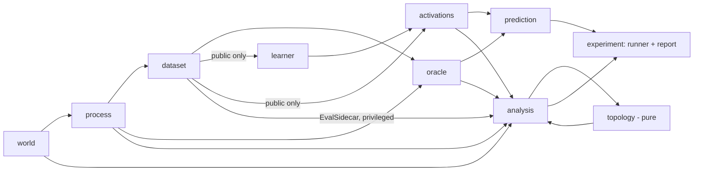
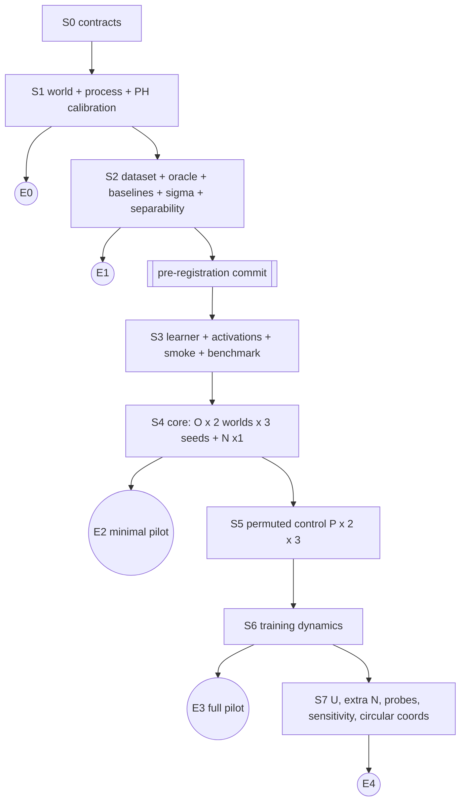

# טופולוגיה של עולם סמוי בייצוגים של Transformer: תוכנית פיילוט מאוחדת ומדורגת

> **סטטוס:** תכנון בלבד. גרסה 2.0, ‏2026-10-12. לא נכתב קוד, לא הותקנו תלויות ולא הורץ דבר.
> **מקורות:** איחוד של שלוש טיוטות: `he` (נקראה A), ‏`he2` (נקראה B) ו־`PILOT_DESIGN.md` (נקראה C).
> **עיקרון מבני:** הבנייה וההרצה מחולקות לשלבים. כל שלב מסתיים ב**נקודת יציאה** שמפיקה תוצר תקין ובר־הצגה, גם אם העבודה נעצרת שם.

---

## 0. תקציר

ניצור שני עולמות סינתטיים בגודל $12\times12$ מצבים: **ריבוע** ($\beta_1=0$) ו**גליל** ($\beta_1=1$). בשניהם תתבצע הליכה מקרית עצלה ומקומית. כל מצב פולט סמל שרירותי מתוך 36 סמלים, לפי שדה פליטות חופף. נאמן Transformer סיבתי קטן מאפס לחזות את הסמל הבא, והוא יראה את הסמלים בלבד. ננתח את ה־residual stream בעזרת הומולוגיה מתמידה (PH) ונשווה אותו לארבעה מרחבי ייחוס: העולם, שדה הפליטות, מצבי האמונה של מנבא בייסיאני מדויק, והתפלגויות העתיד.

**הממצא היחיד שאליו מכוונים (F1):** האם האימון מגביר אות H₁ מתמיד ב־residual stream הסופי, אות שמבחין בין הגליל לריבוע מעבר למה שקיים באתחול. הניגוד הזה מוגדר מראש, ונדרש שיהיה עקבי בשלוש חזרות ובכל קבוצות הדגימה.

כל שאר הניתוחים נועדו לפרש את F1, ואינם ממצאים נפרדים:
- האם הגאומטריה עוקבת אחרי האמונה שנבנית מההיסטוריה, או רק אחרי הסמל האחרון;
- האם האות שורד כשמערבבים את הפליטות;
- מתי האות מופיע במהלך האימון.

**מה נלקח מכל טיוטה:**
- **מ־B:** השלד, העולמות, שדה הפליטות, שערי התוקף, PH על אקטיבציות גולמיות, מדד $S$ והניגוד מול האתחול.
- **מ־A:** ההשוואה בין אמונה מ־32 סמלים לאמונה מסמל אחד, קבוצות דגימה זרות כמעטפת רעש, מסלול קיצוץ מוגדר מראש, וההערה על HMM שפולט ממצבים לעומת HMM שפולט מקשתות.
- **מ־C:** בקרת פליטה מעורבבת מותאמת, checkpoints בפריסה לוגריתמית, סף מחמיר לתועלת ההקשר, מטריצת נצפות, והספרות הקרובה.

**תיקונים לפגמים שנמצאו בהשוואה בין הטיוטות:**
- בקרת השלילה כבר אינה משמשת לכיול סף. ב־C זה יצר מעגליות.
- אין השוואת bottleneck בין דיאגרמות שחושבו במטריקות שונות (A).
- עולם הרצועה 16×4 הוחלף, כי חצי ממצביו יושבים על הגבול (A).
- נמנעו ריצות שלילה כפולות.

---

## 1. שאלה, השערות והבחנות יסוד

### 1.1 שאלה

כשמאמנים לחזות את הסמל הבא על רצפים מעולם בעל טופולוגיה ידועה, האם נוצר בייצוג תלוי ההקשר מבנה שמשקף את הטופולוגיה של העולם? ואם כן, האם הוא נובע מגאומטריית התצפיות, מהאמונה שנבנית מההיסטוריה, או רק ממה שנחוץ לחיזוי?

### 1.2 השערות ניתנות להפרכה

| # | השערה | מדד | הפרכה או הגבלה |
|---|---|---|---|
| **H1 (ראשית)** | האימון מגביר אות H₁ שמבחין בין גליל לריבוע | $D_r$ (§7.3), בכל חזרה $r$ ובכל אחת משמונה קבוצות הדגימה | $D_r\le0$ באחת החזרות או ביותר מקבוצה אחת; או שהאות קיים באותה מידה באתחול; או שהוא נעלם תחת מטריקה או דגימה חלופית |
| H2 (תוספת ההיסטוריה) | הגאומטריה של האקטיבציות קרובה יותר לאמונות אחרי 32 סמלים מאשר לאמונה מהסמל האחרון בלבד | $\Delta_\text{geom}$, גם בתוך זוגות עם אותו סמל אחרון (§7.4) | $\Delta_\text{geom}\le0$, או שהתוצאה נעלמת כשמתנים על הסמל האחרון |
| H3 (מה הלמידה מוסיפה) | תחת פליטות מעורבבות (P, §3.3) עדיין $D_r>0$, כלומר המבנה נלמד מהדינמיקה ולא רק משדה הפליטות | $D_r$ ו־$\Delta_\text{geom}$ בתנאי P | אם $D_r\le0$ ב־P אף שהמודל עבר את שער הלמידה, האות ב־O נובע מגאומטריית E |
| H4 (תזמון) | $S$ עולה רק אחרי שהמודל מתחיל להשתמש בהיסטוריה, כלומר אחרי שה־regret יורד מתחת ל־$G_C$ (§6.3) | עקומות $S$ ו־regret לאורך 12 checkpoints. ריכוז השינוי ב־$S$ בזמן נבחן מול null שמערבב את סדר ה־checkpoints (כמו ב־Malhotra et al.) | אם $S$ עולה לפני שימוש בהיסטוריה, המבנה נובע מסטטיסטיקת הסמלים בלבד |
| H0 (שלילה) | בפליטות זהות לא ניתן ללמוד דבר על המצב הסמוי | האמונה קבועה; NLL ≥ $H(W)$ | אם NLL נמוך מ־$H(W)$ מעבר לטווח הסמך, יש זליגה או באג |

### 1.3 זיהוי ≠ שימוש ≠ הכרח

הפיילוט יכול **לזהות** מבנה ולמדוד את המתאם שלו עם החיזוי. הוא אינו יכול להראות שהמודל **משתמש** במבנה, כי לשם כך צריך התערבות באקטיבציות, וזו הרחבה. הוא גם אינו יכול להראות שהמבנה **נחוץ** לחיזוי. מרחבי העתיד $F_1, F_2$ מראים רק אילו הבחנות נחוצות לחיזוי עד אופק 2. אין כאן הנחה ששפה טבעית, אקטיבציות או אמונות הן יריעות. הומולוגיה של קומפלקס Rips היא תכונה של נתונים ומטריקה בקנה מידה נתון, ואינה מוכיחה הומאומורפיזם.

---

## 2. נקודות יציאה: מה מקבלים בכל עצירה

| יציאה | אחרי שלב | מה עובד ומוצג | מה מותר לטעון | ריצות אימון |
|---|---|---|---|---|
| **E0** | S1 | עולם, קומפלקס, דינמיקה ופליטות, וכיול PH על אמת ידועה | "צינור ה־PH מזהה את הגליל ומבחין בין מחזורי גרף לחורי משטח" | 0 |
| **E1** | S2 | נתונים, מנבא מדויק, בסיסי השוואה, וטבלת הבחנה טופולוגית בין המרחבים | "אילו הבדלים טופולוגיים קיימים בעיקרון בין העולם, הפליטות, האמונות והעתידים", בלי מודל | 0 |
| **E2** (פיילוט מינימלי) | S4 | ניסוי מרכזי: 2 עולמות × 3 זרעים + שלילה | תוצאת F1 (חיובית, שלילית או לא מכריעה) ו־H2 | 7 |
| **E3** (פיילוט מלא) | S5 + S6 | בקרת פליטה מעורבבת ודינמיקת אימון | H3 ו־H4 | 13 |
| **E4** (פיילוט מורחב) | S7 | בקרת סמל ייחודי, שלילה נוספת, probes, רגישות מלאה וקואורדינטות מעגליות | חיזוק הפרשנות | 17 |

**כלל:** כל יציאה מפיקה README עם הממצא בגבולות שלו. שלבים שלא בוצעו מסומנים במפורש "לא בוצע", ולא מושמטים.

---

## 3. תהליך יצירת הנתונים

### 3.1 עולמות (החלטה סגורה)

סריג $12\times12$ עם מרווח 1 ושכנות של 4. יש $N=144$ מצבים עם מזהים צפופים 0..143. המזהים שרירותיים, והקואורדינטות זמינות רק למחולל ולניתוח.

| עולם | הדבקה | $V$ | $E$ | $F$ | $\chi$ | $\beta$ מעל $\mathbb{F}_2$ | מחזורי גרף $E-V+1$ |
|---|---|---|---|---|---|---|---|
| ריבוע | אין | 144 | 264 | 121 | 1 | (1,0,0) | 121 |
| גליל | ציר x מחזורי | 144 | 276 | 132 | 0 | (1,1,0) | 133 |

- **הגרף אינו המשטח.** גם בריבוע יש לגרף 121 מחזורים, אחד סביב כל פאה. בקומפלקס הפאות האלה מלאות, ולכן אינן חורים. $\beta$ מחושב מדרגות מטריצות השפה $\partial_1,\partial_2$ מעל $\mathbb{F}_2$, ונבדק ש־$\partial_1\partial_2=0$.
- **מטריקה ראשית:** מרחק אינטרינזי שטוח. בריבוע $d_M=\sqrt{\Delta x^2+\Delta y^2}$. בגליל $d_M=\sqrt{\min(|\Delta x|,12-|\Delta x|)^2+\Delta y^2}$. **מטריקת רגישות:** מרחק בגרף. **טורוס** ($\beta=(1,2,1)$) **ומביוס** הם הרחבות. מביוס וגליל שקולים הומוטופית, ולכן $\beta$ לבדו אינו מבחין ביניהם.

### 3.2 דינמיקה

$p_\text{stay}=0.2$, ו־0.2 לכל אחד מארבעת הכיוונים. ניסיון לחצות שפה הופך להישארות במקום. בגליל המעבר דרך התפר מחזורי. $T[i,j]=P(z_{t+1}=j\mid z_t=i)$ סימטרית ודו־סטוכסטית, ולכן $\pi$ אחידה. יש לולאות עצמיות, ולכן השרשרת אינה מחזורית. אין פעולות נצפות.

**הבדלים שנשארים בין העולמות** (נמדדים ומדווחים): שיעור ההישארות במצבי שפה, הקוטר, הפער הספקטרלי, זמן הערבוב, ונרמול הפליטות ליד השפה. זו השוואה בין **שני תהליכים**, ולא התערבות בטופולוגיה בלבד.

### 3.3 הצמדת סמלים: חלופות ובחירה

| חלופה | מה בודקים | מעמד |
|---|---|---|
| חופפת: גאוסיאנים סביב מרכזים | אי־ודאות רציפה וצמצום שלה בעזרת היסטוריה | **O: ניסוי מרכזי** (S4) |
| **מעורבבת לפי צירים (מותאמת):** $E_P[(x,y),\cdot]=E_O[(\sigma_x(x),\sigma_y(y)),\cdot]$, עם שתי פרמוטציות אקראיות קבועות: אחת לעמודות ואחת לשורות של הסריג | למידה מהדינמיקה כשאין חלקות תצפיתית. אותו $V$, אותה קבוצה של שורות, ולכן אותו $H(W\mid Z)$. ‏$p(w)=\pi E$ זהה כי $\pi$ אחידה. **בנוסף נשמרת המכפלתיות של E** (ראו בהמשך) | **P: בקרה מותאמת** (S5) |
| מעורבבת מלאה: $E=\Pi E_O$ עם פרמוטציה כללית של 144 המצבים | כמו P, אבל שוברת גם את המכפלתיות | הרחבה |
| זהה בכל המצבים | זליגה ושיעור חיובים שגויים | **N: שלילה** (S4 ו־S7) |
| סמל ייחודי לכל מצב | למידת דינמיקה כשהמצב גלוי, $V=144$ | **U: בקרת תקינות** (S7) |
| סמל לכל אזור; לפי חלק מהתכונות; מרכזים אקראיים לעומת FPS | aliasing, מחיקת מידע מכוונת, כיסוי | הרחבות |

**פרטי O:** $V=36$ מרכזים על רשת $6\times6$ קבועה, $c_{ab}=(0.5+2a,\ 0.5+2b)$ עבור $a,b\in\{0..5\}$. המרכזים אינם מצבים. ההגדרה:
$$E_{zj}=\frac{\exp[-d_M(z,c_j)^2/2\sigma^2]}{\sum_k\exp[-d_M(z,c_k)^2/2\sigma^2]}.$$
בגליל המרכזים מכסים את ההיקף באופן אחיד: 6 מרכזים במרווח 2 על היקף 12. שמות הסמלים עוברים פרמוטציה שרירותית, והיא נשמרת.

**מכפלתיות של O (נמצא בסקירת הספרות):** גם המונה של E וגם המכנה שלה מתפרקים למכפלה, ולכן $E_O[(x,y),(a,b)]=E^x[x,a]\,E^y[y,b]$ במדויק. כלומר כל סמל הוא זוג של קריאות רועשות, אחת לכל ציר. גם הדינמיקה כמעט מתפרקת: בכל צעד זז רק ציר אחד. לפי Shai et al. 2026 ("Transformers learn factored representations"), מודלים נוטים לייצג גורמים כמעט בלתי תלויים בתת־מרחבים אורתוגונליים. לכן צפוי שהמחזור של הגליל יישב בתת־מרחב של ציר x. פרמוטציה כללית של המצבים הייתה שוברת גם את החלקות וגם את המכפלתיות, ומערבבת את שתי ההשפעות. **P מוגדרת כפרמוטציה לפי צירים כדי לשבור רק את החלקות.** הבדל שנשאר בין התנאים: ב־P המכפלה נשמרת, אבל השכנות בכל ציר נהרסת.

**הערה על בקרה U:** שם $V\ne36$, ולכן NLL גולמי אינו בר־השוואה. ענן האמונות שלה הוא קודקודי הסימפלקס, ובמרחק Hellinger כל הקודקודים במרחק שווה זה מזה. לכן **לא מצפים** לראות בו את הגליל. U אינה בקרה חיובית ל־PH. הבקרה החיובית היא העולם עצמו עם $d_M$.

### 3.4 כיול σ (לפני כל אימון, מהמחולל בלבד)

המועמדים נבדקים בסדר הזה: $\sigma\in(1.25,\ 0.75,\ 2.0)$. נבחר הראשון שעומד בשלושת התנאים **בשני העולמות**:
1. האנטרופיה הממוצעת של $b^{(1)}$ (אמונה מסמל יחיד) היא לפחות $\log 2$, כך שהמצב אינו כמעט גלוי.
2. $G_C=\overline{\mathrm{KL}}(q_C\,\|\,q_\text{last})\ge 0.10$ nats, כך שלהיסטוריה יש ערך ממשי. הסף מחמיר מזה של B (0.02).
3. לכל סמל $p(w)\ge 0.5/V$.

**מסלול נפילה:** אם אף מועמד לא עומד בכל התנאים, נבחר המועמד עם $\min_\text{world} G_C$ הגבוה ביותר, בתנאי שהוא לפחות 0.03 nats. במקרה כזה הפיילוט מסומן "תועלת הקשר חלשה" ברישום המוקדם. אם גם זה לא מתקיים, עוצרים ומתקנים את התכנון, בלי sweep אוטומטי. כל המועמדים מדווחים.

---

## 4. מוסכמות רצף ומנבא מדויק

### 4.1 סדר פליטה–מעבר, חלון ומסכות

```text
z_1 ~ pi ; for t = 1..33: emit w_t ~ E[z_t,:] ; if t < 33: z_{t+1} ~ T[z_t,:]
model input  = [BOS, w_1, ..., w_32]   (33 positions, p = 0..32)
model target = [w_1, ..., w_33]
position p sees history w_{1:p} (p symbols) and predicts w_{p+1}
primary analysis position: p = 32 (one history per trajectory)
```

- המסכה סיבתית. אין packing, אין padding, ואין KV-cache משותף בין רצפים. BOS הוא מזהה קלט בלבד, ואינו יעד.
- **השוואה למנבא מדויק:** כל חלון מתחיל מ־$\pi$, וזה בדיוק המידע שיש למודל. ה־HMM כאן פולט **ממצבים**. אצל Shai et al. ה־HMM פולט מקשתות, ולכן צריך להשוות נוסחאות בזהירות.

### 4.2 סינון בייסיאני (וקטורים הם שורות)

$$a_1=\pi,\quad b_t=\frac{a_t\odot E_{:,w_t}}{a_tE_{:,w_t}},\quad a_{t+1}=b_tT,\quad q_t=b_tTE,\quad q_0=\pi E.$$

- **אמונה קנונית בעמדה $p$:** $b_p=P(z_p\mid w_{1:p})$. ההתפלגות החזויה היא $q_p$.
- **בסיס של סמל יחיד:** $r_w=\pi\odot E_{:,w}/(\pi E_{:,w})$ ו־$q_\text{last}=r_{w_p}TE$. הם מאפשרים לשאול מה ההיסטוריה מוסיפה, בלי לחשוף את $z$. בהמשך $b^{(1)}\equiv r_{w_{32}}$ ו־$b^{(32)}\equiv b_{32}$.
- **חישוב:** float64, עם נרמול בכל צעד. אם הראיה שווה 0 נזרקת `IMPOSSIBLE_HISTORY`, בלי תיקון שקט באמצעות epsilon.
- **מיפוי לספרות:** Shai et al. ו־Piotrowski et al. עובדים עם HMM שפולט מקשתות, $T^{(x)}_{ij}=\Pr(x,s_j\mid s_i)$. בסדר "פליטה ואז מעבר" שלנו מתקיים $T^{(x)}=\mathrm{diag}(E_{:,x})\,T$. לכן האמונה $\eta$ שלהם אחרי סמל שווה ל־$a_{p+1}=b_pT$ שלנו, ולא ל־$b_p$. שתי האמונות קשורות במיפוי ליניארי קבוע. בהשוואה לתוצאות שלהם משתמשים ב־$a_{p+1}$.

### 4.3 עתידים ונצפות

$F_1=b\,TE\in\Delta^{35}$. ‏$F_2[i,j]=b\,T\,\mathrm{diag}(E_{:,i})\,T\,E_{:,j}\in\Delta^{1295}$, כלומר התפלגות משותפת של שני הסמלים הבאים, ולא מכפלה של התפלגויות שוליות.

**מטריצת הנצפות** $O_k=[TE;\ T\,\mathrm{diag}(E_{:,\cdot})TE;\dots]$ נבדקת דרך הדרגה והערכים הסינגולריים שלה עבור $k\le3$. כיווני אמונה שנמצאים בגרעין שלה אינם נחוצים לחיזוי עד אופק $k$. כש־$N>V$, המיפוי $b\mapsto bTE$ אינו חד־חד־ערכי על כל הסימפלקס. ובכל זאת, צריך לבדוק **בנתונים בפועל** אם יש זוגות היסטוריות קרובים ב־$F_1$ ורחוקים ב־$F_2$. אם אין זוגות כאלה, לא טוענים שהמודל מייצג מידע מעבר לסמל הבא.

---

## 5. חמש הגדרות קרבה ומרחבי השוואה

| מרחב | נקודות | מטריקה ראשית | נימוק | רגישות |
|---|---|---|---|---|
| עולם | 144 מצבים | $d_M$ אינטרינזית | הגאומטריה שהמחולל מניח. אמת המידה נמדדת על הקומפלקס, ו־VR על $d_M$ משמש לכיול | מרחק בגרף |
| שדה פליטות | 144 שורות של $E$ | Hellinger $=\|\sqrt p-\sqrt q\|_2/\sqrt2$ | מטריקה אמיתית וחסומה, שאינה מייחסת משמעות למספרי הסמלים | $\sqrt{\mathrm{JSD}}$ |
| אמונות | $b^{(32)}$ ו־$b^{(1)}$ על **אותן** היסטוריות | Hellinger | **אינה** משתמשת ב־$d_M$, ולכן מבנה שיימצא בה לא הוכנס מבחוץ | $\sqrt{\mathrm{JSD}}$. ‏$W_1$ עם $d_M$ רק כרגישות מתויגת, כי הוא מכניס את גאומטריית העולם |
| עתידים | $F_1,F_2$ על אותן היסטוריות | Hellinger | הבחנות שנחוצות לחיזוי עד אופק 2. זו עדשה נוספת, ולא עולם חדש | $\sqrt{\mathrm{JSD}}$ |
| אקטיבציות | `resid_post_3` לפני LN סופי, $\mathbb{R}^{128}$ | אוקלידית **גולמית**, ללא PCA | הגאומטריה שהאימון יצר, בלי עיבוד שמכוון לתוצאה | chord על וקטורים מנורמלים; PCA-32 (מותאם על dev); $M=256$ |

- **מה לא עושים:** 1−cos אינו מטריקה, ולכן משתמשים ב־chord. אין מרחק גאודזי מבוסס k-NN, כי בחירת $k$ יוצרת או מוחקת קישוריות. אין UMAP או t-SNE כבסיס למסקנה. אין ממוצעים לפי $z$ בניתוח הראשי, כי מיון לפי המצב האמיתי מכניס את מבנה העולם מבחוץ.
- **שקילות לחיזוי:** $d_F=0$ פירושו שקילות רק עד אופק 2. זו פסאודו־מטריקה, ונקודות זהות מאוחדות עם מיפוי מזהים שמור.

---

## 6. מודל, אימון, בסיסים ומדדי חיזוי

### 6.1 מודל (B ו־C)

decoder-only עם pre-LN: 4 בלוקים, $d=128$, 4 ראשים, $d_\text{mlp}=512$, GELU, embedding מיקום נלמד, LN סופי, unembedding לא קשור, dropout=0. אוצר הקלט הוא $V+1$ (עם BOS) ואוצר הפלט $V$. כ־0.8M פרמטרים.

**נקודות hook:** `embed`, `resid_post_0..3`, ‏`ln_final_out`.

### 6.2 אימון

- AdamW עם lr=1e-3, warmup של 200 צעדים, cosine עד 5,000 צעדים, wd=0.1, clip=1.0, batch=128 חלונות של 33 עמדות. בסך הכול כ־21M מטרות לריצה. זה פי 5 מ־B ופחות משליש מ־C.
- **לא מניחים שיש GPU.** לפי הערכה, ריצה אחת על מעבד רגיל לוקחת 15–45 דקות, ועל GPU דקות בודדות. **זו הנחה שנמדדת בשלב S3**, ולפי התוצאה בוחרים בין הרצה מקומית על המעבד לבין GPU חיצוני (§10).
- **נתונים לכל חזרה:** 131,072 מסלולי train (כ־4.3M טוקנים, uint8), ‏4,096 dev ו־4,096 test. כולם עצמאיים ומתחילים מ־$\pi$.
- **checkpoints בפריסה לוגריתמית, תמיד נשמרים:** 0, 50, 100, 200, 400, 700, 1000, 1500, 2000, 3000, 4000, 5000.
- **הניתוח הראשי בצעד 5000**, בלי לבחור את ה־checkpoint "היפה" ביותר.

### 6.3 בסיסים ומדדים

- **בסיסים לחיזוי:** unigram ו־bigram מ־train עם החלקה שנבחרת על dev; ‏$q_\text{last}$; ‏$q_C$ (המנבא המדויק).
- **בסיסי ייצוג** (עוברים את אותו צינור PH ו־geom בדיוק):
  - **(R0)** אקטיבציות של המודל לפני אימון;
  - **(R1)** embedding של הסמל האחרון במודל המאומן;
  - **(R2) ערבוב עם הסמל הקודם:** $x(h)=\tfrac12[\phi(w_{32})+\phi(w_{31})]$, כאשר $\phi$ הוא spectral embedding של מטריצת המעברים בין סמלים, $E^\top\mathrm{diag}(\pi)TE$, עם 8–16 רכיבים, בלי מודל. ‏Park et al. מראים ש־PCA של ממוצעים לפי צומת שווה לרכיבי ה־spectral embedding כאשר אנרגיית Dirichlet מינימלית. הניתוח ב־LessWrong מראה שצעד ערבוב אחד בין שכנים מספיק כדי ליצור מבנה סריג גם מוקטורים אקראיים;
  - **(R3) ממוצע על כל ההקשר:** $x(h)=\tfrac1{32}\sum_t\phi(w_t)$. זה מה ש־attention כמעט אחיד מחשב, וכך תואר המנגנון אצל Brenner et al.
- R2 ו־R3 בודקים אם האות מוסבר על ידי חישוב פשוט שאינו דורש סינון בייסיאני. בתנאי P, הגרף בין הסמלים מתערבב, ולכן R2 ו־R3 צפויים לאבד את המבנה. בדיוק זה הופך את P לבקרה הנכונה.
- **regret** $=\overline{\mathrm{KL}}(q_C\,\|\,p_\text{model})$, מחושב במדויק לכל היסטוריה. הוא המדד הראשי, ו־NLL מדווח לצידו.
- **שער למידה:** $\text{captured}=1-\text{regret}/G_C\ge0.8$. אם המודל לא עובר את השער, היעדר מבנה פירושו "המודל לא למד", ולא ממצא שלילי.
- **אי־ודאות:** bootstrap לפי מסלולים. 3 החזרות מוצגות כל אחת בנפרד, בלי p-value על טוקנים.

---

## 7. פרוטוקול PH והכרעה

### 7.1 דגימה

שמונה **קבוצות זרות** של 512 מסלולי test. מכל מסלול נלקחת היסטוריה אחת, בעמדה 32. הקבוצות נקבעות מראש לפי זרע ניתוח, ומשותפות לכל השכבות, ה־checkpoints והמרחבים. קבוצה 1 משמשת לעקומות האימון, וכל שמונה הקבוצות משמשות בצעדים 0 ו־5000.

### 7.2 פילטרציה

- **Vietoris–Rips** מעל $\mathbb{F}_2$, ממדים 0 ו־1, עם סף שסוגר את כל פסי H₁. פס שנחתך לפני מותו מסומן `censored`.
- **סקאלה:** $s$ הוא האחוזון ה־95 של המרחקים החיוביים. נשמרים גם המרחקים הגולמיים וגם $s$.
- **ענן קבוע:** מסומן `collapsed`, ומקבל $S=0$. זה מצב תקין ולא חריגה.

### 7.3 מדד ראשי ו־F1

$$S=\max_{(u,v)\in D_1,\ v<\infty}\frac{v-u}{s},\qquad S=0\ \text{אם אין H₁}.$$

לכל חזרה $r$ ולכל קבוצה $i$, כאשר בגליל ובריבוע **מצמידים את אותו אינדקס קבוצה**:

$$D_{r,i}=(S^{\text{cyl}}_{\text{final},i}-S^{\text{cyl}}_{\text{init},i})-(S^{\text{sq}}_{\text{final},i}-S^{\text{sq}}_{\text{init},i}).$$

**F1 נתמך** אם מתקיימים שלושה תנאים:
1. $D_{r,i}>0$ בלפחות 7 מתוך 8 קבוצות, בכל אחת משלוש החזרות.
2. החציון של $D_{r,\cdot}$ גדול מ־$u_r$, האחוזון ה־95 של $|S_i-S_j|$ בין קבוצות בתוך אותה ריצה. $u_r$ היא מעטפת רעש הדגימה, כמו ב־A.
3. כל המודלים עברו את שער הלמידה.

**F1 נדחה** אם הסימן הפוך או לא עקבי, בתנאי ששערי התוקף עברו. **התוצאה לא מכריעה** אם שער כלשהו נכשל.

ארבעת ערכי $S$ מוצגים תמיד לצד $D$, כדי ש־$D$ לא יסתיר את מקור ההבדל. ‏$S$ גבוה **אינו** $\beta_1=1$. נשמר גם המדד המשני $\pi_\text{max}=\text{death}/\text{birth}$.

**רצפת רעש:** לכל ענן מחושב גם $S$ של שני עננים גאוסיים באותו $M$ ובאותו ממד: אחד איזוטרופי ואחד עם קווריאנס מותאם, 20 דגימות לכל אחד. הם אינם משמשים כסף להחלטה, אלא כהקשר להבנת גודל האות. Malhotra et al. מדווחים שענן גאוסי איזוטרופי בגודל ובממד של עננים כאלה מייצר כ־238 פסי H₁ מלאכותיים. לכן אין לספור פסים בלי ייחוס כזה.

### 7.4 תוספת ההיסטוריה (H2)

על אותם זוגות בתוך קבוצה:

$$\Delta_\text{geom}=\rho_s(d_A,d_{B32})-\rho_s(d_A,d_{B1}),$$

כאשר $\rho_s$ הוא מתאם Spearman. המדד מחושב פעם אחת על כל הזוגות, ופעם נוספת **רק על זוגות עם אותו $w_{32}$**. ההתניה הזו מסירה את האפשרות שהגאומטריה מוסברת על ידי הסמל האחרון. מתאמים בין זוגות אינם מבחן מובהקות, כי הזוגות חולקים נקודות. ההחלטה מתקבלת לפי הסימן בשלוש החזרות ובשמונה הקבוצות.

**השוואת bottleneck** בין דיאגרמות של מרחבים שונים מותרת רק כתיאור, ולעולם אינה מדד ראשי.

### 7.4א ניתוח לפי שכבה (משני, רשום מראש)

$S$ ו־$\Delta_\text{geom}$ מחושבים בכל hook, וגם על שרשור כל ה־residuals. יש לכך שלוש סיבות מהספרות:
- אצל Shai et al. הגאומטריה של RRXOR הופיעה רק בשרשור כל השכבות.
- אצל Piotrowski et al. הייצוג אחרי attention הוא עדכון אמונה מוגבל, שונה מהאמונה המלאה, וה־MLP מעוות אותו לאמונה המלאה.
- אצל Brenner et al. הייצוג אחרי attention מקודד ממוצע מנורמל על ההיסטוריה.

**תחזית גישושית:** במוצא ה־attention הראשון, שבו מתבצע מיצוע על ההקשר (R3), החור עשוי "להתמלא", כי ממוצע של נקודות על גליל נופל בתוך הקמור שלהן. אם כך, H₁ אמור להופיע רק בשכבות מאוחרות יותר. ההכרעה ב־F1 נשארת על האתר הראשי בלבד.

### 7.5 שלילה (בלי מעגליות)

תנאי N **אינו משמש לכיול שום סף**. הוא נבדק בשלוש בדיקות:
- NLL ≥ $H(W)$ בתוך טווח הסמך. כישלון כאן מעיד על זליגה.
- האמונה קבועה, $b=\pi$.
- $S_\text{final}-S_\text{init}$ מדווח, כמדד לכמה $S$ יכול להשתנות **מהארכיטקטורה בלבד**.

ייתכן שיופיעו מחזורים גם בענן הגולמי, כי ההיסטוריות שונות זו מזו. הם אינם ראיה לעולם הסמוי.

### 7.6 טבלת פירוש

| תוצאה | מסקנה מותרת |
|---|---|
| F1 נתמך, H2 נתמך, H3 נתמך | אות H₁ שנלמד מההיסטוריה ומהדינמיקה ומבחין בין העולמות. זו עדיין לא הוכחה שהמודל משתמש בו |
| F1 נתמך ב־O ולא ב־P | המבנה ככל הנראה עובר משדה הפליטות |
| F1 נתמך, H2 נדחה | המבנה מוסבר על ידי הסמל האחרון |
| F1 נתמך, אבל גם R2 או R3 מראים $D>0$ באותו סדר גודל | האות מוסבר בערבוב סמלים פשוט (previous-token או ממוצע הקשר), ואין צורך בסינון בייסיאני כדי להסביר אותו. המסקנה נשענת אז על P |
| F1 נדחה, המודל עבר את שער הלמידה, אמונות/עתידים מבחינים בין העולמות | חיזוי טוב בלי אות H₁ גולמי במדידה זו. ייתכן קידוד בגאומטריה אחרת |
| המרחבים הלא־נלמדים לא מבחינים בין העולמות (S2) | אין חתימה שאפשר לצפות לה. השאלה אינה ניתנת להכרעה במערך הזה |
| הצינור נכשל בזיהוי הגליל הידוע (S1) | כשל מדידה, ולא מפרשים אקטיבציות |

---

## 8. רכיבים וחוזים

**עשרה מודולים לוגיים** בחבילה אחת (`topo_pilot`). אין שירותים, אין מצב גלובלי משתנה, ואין סקריפט אחד שמבצע הכול. כל מודול מגיע עם `tests/<module>` שרץ בלי שאר המודולים (בעזרת stubs).

### 8.0 מוסכמות משותפות (`contracts`)

- **מעטפת תוצר:** `schema_version` (semver; גרסה ראשית לא מוכרת נכשלת), `artifact_type`, `artifact_id=sha256(canonical(type, config, parent_ids, schema_version))[:16]`, `parent_ids`, `config`, `seed_map`, `producer_version` (git sha), `created_utc` (אינו חלק מהזהות), ‏`shapes`, ‏`dtypes`, ‏`payload_sha256`, `status∈{complete, incomplete}`. תוצר במצב incomplete אינו קלט תקף.
- **זרעים:** שלושה זרעי־אב, 1729, 2718 ו־3141. זרעי הרכיבים נגזרים מ־digest יציב של `(master, world_id, emission_id, component, split)`. אין שימוש ב־RNG גלובלי. שמות הזרעים: `world, emission_perm, symbol_names, train, dev, test, init, batch_order, panels, probe, resample`.
- **שגיאות:** `StageFailure{stage, code, component, artifact_id, check, detail, recoverable}`. הפרת אינווריאנט עוצרת את הריצה. מצב "לא ניתן להכרעה" (למשל `NONSEPARABLE`, `COLLAPSED`) הוא **סטטוס בתוצאה**, ולא חריגה.
- **גבול המידע:** `ArtifactStore.load(type, consumer)` אוכף רשימת הרשאות. אם `learner` או `activations` מבקשים `EvalSidecar`, נזרקת `LEAKAGE`.
- **מוסכמת יישור:** טבלת היישור מ־§4.1 מוגדרת כאן בלבד, וכל המודולים מייבאים אותה.

### 8.1 חוזים

**world**
- **אחריות:** בניית הקומפלקס, ההדבקה, $d_M$ ומטריקת הגרף. **לא** אחראי לסמלים או למסלולים.
- **קלט ופלט:** `WorldConfig{family, n=12, spacing=1}` → `WorldSpec{state_ids int32[N], coords f64[N,2], edges int32[E,2], faces int32[F,4], d1, d2 (sparse F₂), dist f64[N,N], dist_graph f64[N,N], betti_expected int[3], betti_computed int[3]}`.
- **אינווריאנטים:** $\partial_1\partial_2=0$; ‏$\beta_\text{computed}=\beta_\text{expected}$; ‏dist סימטרית, עם אפסים באלכסון ומקיימת את אי־שוויון המשולש; בגליל $d((11,y),(0,y))=1$.
- **שגיאות:** `INVALID_GLUE`, `BETTI_MISMATCH`, `NON_METRIC`.
- **תלויות:** numpy ו־scipy.sparse. אסור לו לקבל $E$, tokens או מודל.
- **אימות:** קומפלקסים קטנים בגודל $n\in\{3,4\}$, ונוסחאות מרחק דרך התפר.

**process**
- **אחריות:** שתי פונקציות נפרדות, `make_transition(world, cfg)` ו־`make_emission(world, cfg)`, שמחזירות תוצרים נפרדים. בניית E אינה מקבלת $T$. בניית T אינה מקבלת $E$.
- **פלט:** `TransitionSpec{T f64[N,N], pi f64[N], event_order="emit_then_transition"}` ו־`EmissionSpec{E f64[N,V], mode∈{overlap, permuted, identical, unique}, centers f64[V,2]|null, sigma, state_perm int32[N]|null, symbol_perm int32[V], diagnostics{H_W_given_Z, H_W, p_w, coverage, row_entropy_quantiles}}`.
- **אינווריאנטים:** סכומי השורות 1 בסבילות $10^{-12}$; ‏$\pi T=\pi$; מעברים רק לשכנים או לעצמו; ב־permuted קבוצת השורות זהה ל־O; ב־identical כל השורות שוות; ב־unique ‏E היא פרמוטציה.
- **שגיאות:** `NONSTOCHASTIC`, `STATIONARITY_FAILURE`, `INVALID_SIGMA`, `STATE_ORDER_MISMATCH`.
- **אסור:** אקטיבציות, ביצועי מודל.
- **אימות:** פנים, פינה ותפר; שימור ה־multiset; סטטיסטיקות סגורות־צורה למקרי קצה של σ.

**dataset**
- **אחריות:** דגימה בסדר הקנוני, פיצול לפי מסלולים, הפרדה בין תצוגה ציבורית למידע פרטי, ובניית `HistoryIndex`.
- **פלט:**
  - `ObservationSet{split, sequence_id int64[R], tokens uint8[R,33]}`, ציבורי.
  - `EvalSidecar{sequence_id, z int16[R,33], privileged=true}`, עבור dev ו־test בלבד.
  - `HistoryIndex{history_id, sequence_id, end=32, panel∈{1..8}, tokens_hash}`.
- **אינווריאנטים:** אין `sequence_id` משותף בין splits; האסימון הראשון מתפלג לפי $\pi E$; תדירויות המעברים והפליטות תואמות ל־$T$ ול־$E$ (מבחן $\chi^2$); אין שדה סמוי ב־`ObservationSet`.
- **שגיאות:** `SPLIT_OVERLAP`, `LEAKED_FIELD`, `ALIGNMENT_ERROR`.
- **אימות:** HMM זעיר עם הסתברויות ידניות, וסריקת רשימת ההרשאות של שדות הקלט.

**oracle**
- **אחריות:** סינון מדויק, עתידים, $r_w$ ו־$q_\text{last}$, $G_C$, ומטריצת נצפות. **לא** מקבל $z$.
- **פלט:** `OracleOutputs{history_id[M], b32 f64[M,N], b1 f64[M,N], q f64[M,V], q_last f64[M,V], F2 f32[M,V,V] (panels only), log_evidence, belief_entropy}`, ובנוסף `ProcessDiagnostics{G_C, O_singular_values, sigma_calibration_table}`.
- **אינווריאנטים:** כל השורות מנורמלות; סכימה של $F_2$ על הציר השני נותנת $F_1=q$; ‏$q_0=\pi E$.
- **שגיאות:** `IMPOSSIBLE_HISTORY`, `CONTEXT_MISMATCH`.
- **אימות:** השוואה לספירה מלאה של כל המסלולים ב־$n=3$, $L=4$, עד $10^{-10}$. ב־U מתקבל $b=\delta$, וב־N מתקבל $b=\pi$.

**learner**
- **אחריות:** `ModelSpec`, ‏forward סיבתי, לולאת אימון ו־checkpoints.
- **קלט:** `ObservationSet` (train ו־dev) ותצורות בלבד.
- **פלט:** `Checkpoint{run_id, step, state_dict, optimizer, rng_states, model_cfg, train_cfg, observation_id}` ו־`TrainLog`.
- **אסור:** WorldSpec, ‏T, ‏E, ‏$\pi$, ‏EvalSidecar, ‏Oracle, תוויות טופולוגיה. האכיפה כפולה: רשימת ההרשאות, ובדיקה סטטית שלא מיובאים מודולי oracle, process או world.
- **שגיאות:** `NONFINITE_LOSS`, `CAUSAL_MASK_FAILED`, `HIDDEN_FIELD_REJECTED`, `OOM`.
- **אימות:** שינוי של הקלט בעמדה $j$ לא משנה את ה־logits בעמדות קודמות; שמירה ושחזור של checkpoint מחזירים logits זהים; overfit על 8 רצפים.

**activations**
- **אחריות:** forward במצב eval ובלי gradient, וחילוץ hooks ו־logits עבור `HistoryIndex`.
- **פלט:** `ActivationSet{checkpoint_id, history_id[M], hooks[6], A f32[M,6,128], logits f32[M,V]}`.
- **אינווריאנטים:** סדר השורות זהה ל־HistoryIndex; ה־logits זהים ל־forward רגיל עד $10^{-5}$; אין ממוצעים.
- **אסור:** $z$, ‏$b$, ‏$F$. הקישור אליהם נעשה מאוחר יותר, ב־join מתועד.
- **שגיאות:** `UNKNOWN_HOOK`, `POSITION_MISMATCH`, `INPUT_DIGEST_MISMATCH`.

**prediction**
- **אחריות:** בסיסי השוואה, NLL, regret, שער הלמידה, ו־probes (ב־S7).
- **פלט:** `MetricRecords{run, ckpt, metric_id, value|null, units="nats", status, uncertainty_kind}` ו־`ProbeArtifact`.
- **אינווריאנטים:** join לפי `history_id` בלבד, ובדיוק אחד־לאחד; ה־probe מותאם על dev ונבחן על test.
- **שגיאות:** `JOIN_CARDINALITY`, `INVALID_PROBABILITY`, `PROBE_SPLIT_LEAKAGE`.
- **אימות:** ‏KL(q‖q)=0; מודל קבוע תואם לחישוב ידני.

**topology** (טהור, לא מכיר HMM)
- **פלט:** `distances(X|D, metric) → DistanceArtifact{point_ids, D f64, metric_id, scale s, dedup_map}` ו־`persistence(D) → Diagrams{dim, birth, death, censored}`. מחשב גם `S`, ‏`pi_max`, ‏Betti curves ו־Spearman בין מטריצות.
- **אינווריאנטים:** המטריקה תקינה; H₁ כולל 2-סימפלקסים; אין החלפה שקטה ב־kNN או בקירוב.
- **שגיאות:** `NONMETRIC_DISTANCE`, `PH_RESOURCE_LIMIT`, `CENSORED_RESULT` (סטטוס), `ZERO_SCALE` (סטטוס `collapsed`).
- **אימות:** מעגל, דיסק ונקודה; קנה מידה כפול מכפיל את birth ו־death; פרמוטציה של נקודות אינה משנה את הדיאגרמה; ענן קבוע.

**analysis**
- **אחריות:** בניית חמשת המרחבים על אותן היסטוריות, הפעלת topology וחישוב $D_{r,i}$, $u_r$ ו־$\Delta_\text{geom}$ (כולל ההתניה על הסמל האחרון).
- **הרשאה מתועדת:** קורא `EvalSidecar` רק לצורך תוויות הערכה, כמו קואורדינטות מעגליות ב־S7.
- **אינווריאנט:** כל השוואה מתבצעת על אותם `history_id`.
- **שגיאות:** `SAMPLE_ID_MISMATCH`.
- **אימות:** אם האקטיבציות הן $\sqrt{b^{(32)}}$ עצמן, צריך לצאת $\Delta_\text{geom}>0$.

> ב־B מודול analysis היה חלק מ־topology. כאן הוא הופרד, כדי ש־topology יישאר גנרי וניתן לבדיקה על צורות ידועות.

**experiment** (runner ו־report)
- **runner:** מריץ שלבים (§9) לפי `configs/stage_*.yaml`, בודק שתוצרי ההורה קיימים ושלמים, וכותב `RunManifest` ו־`GateReport`. אינו מכיל חישוב מדעי.
- **report:** קורא **רק** `MetricRecords`, `GateReport` ו־`RunManifest`. מפיק איורים, טבלאות ו־README לפי נקודת היציאה שהושגה. ערך חסר מוצג כ"לא בוצע", ולעולם לא כ־0.
- **שגיאות:** `MISSING_PARENT`, `GATE_FAILED`, `CONFIG_DRIFT`, `INCOMPLETE_RUN`.

### 8.2 סכמות תוצרים (סיכום)

| תוצר | מפתחות זהות | משמעות |
|---|---|---|
| WorldSpec | world_id | $(Z,d_M)$ וקומפלקס תאי |
| TransitionSpec / EmissionSpec | world_id, state_order_hash | $T[i,j]=P(z'=j\mid z=i)$; ‏$E[z,w]=P(w\mid z)$ |
| ObservationSet / EvalSidecar | dataset_id, split, sequence_id | $w_{1:33}$ / $z_{1:33}$ (חסוי) |
| HistoryIndex | history_id = hash(dataset_id, sequence_id, end, tokens_hash) | קבוצות הדגימה הקבועות |
| OracleOutputs | history_id | $b^{(32)}, b^{(1)}, q, q_\text{last}, F_2$ |
| Checkpoint | run_id, step | $\theta$ |
| ActivationSet | checkpoint_id, history_id | $x_\ell(h)$ |
| DistanceArtifact / Diagrams | source_id, metric_id, panel | $D$, ‏PH |
| MetricRecords / GateReport / RunManifest | run_id, stage | תוצאות, שערים, מצב הניסוי |

### 8.3 תרשים תלויות



---

## 9. שלבי בנייה והרצה

כל שלב מוגדר על ידי חמישה דברים:
1. המודולים שהוא בונה או מרחיב;
2. פקודה יחידה, `topo-pilot stage <id> --config configs/stage_<id>.yaml`;
3. התוצרים שהוא קורא, רק מהרישום;
4. התוצרים שהוא כותב;
5. **שער** שנבדק אוטומטית ונכתב ל־`GateReport`.

שלב לא מתחיל אם השער שלפניו נכשל. ‏`--waive <gate> --reason "..."` עוקף את השער, אבל הוויתור נרשם ומופיע בדוח.



| שלב | בונה | פלט עיקרי | שער (אוטומטי) | זמן פעיל |
|---|---|---|---|---|
| **S0** | contracts, ‏skeleton של experiment | ArtifactStore, IDs, יישור, שגיאות, CLI ריק | בדיקות round-trip, יציבות IDs ו־LEAKAGE עוברות | 3–4 שעות |
| **S1** | world, ‏process, ‏topology | WorldSpec ×2, ‏TransitionSpec ×2, ‏EmissionSpec עבור O, P ו־N לשלוש ערכי σ; דוח כיול PH | **G-A:** ‏$\beta$ נכון; VR על $d_M$ מבחין בין הגליל לריבוע (פס ארוך בגליל בלבד); מעגל ודיסק סינתטיים ב־$\mathbb{R}^{128}$ עם רעש ו־$M=512$ מזוהים נכון ב־19 מתוך 20 | 5–6 שעות |
| **S2** | dataset, ‏oracle, ‏prediction (בסיסים), ‏analysis (מרחבים לא־נלמדים) | נתונים, OracleOutputs, ‏בחירת σ, **טבלת הבחנה**: $S$ ו־Spearman עבור E, ‏$b^{(1)}$, ‏$b^{(32)}$, ‏$F_1$, ‏$F_2$ בשני העולמות ובתנאים O ו־P | **G-B:** ההשוואה לספירה מלאה עוברת, ו־N ו־U מתנהגים כצפוי. **G-C:** σ נבחר לפי §3.4. **G-D:** אין שדה סמוי בתצוגה הציבורית | 7–8 שעות |
| — | **רישום מוקדם** | `PREREGISTRATION.md` ב־git: השערות, σ, ספים, אתר, checkpoint, קבוצות, טבלת ההבחנה | commit לפני כל אימון | 1 שעה |
| **S3** | learner, ‏activations | ריצת עשן על גליל O עם זרע 1729; מדידת זמן וזיכרון; בדיקות סיבתיות ויישור | **G-E:** בתנאי O בגליל מתקיים captured ≥ 0.8; תחזית הזמן לכל הריצות נכנסת בתקציב (§10) | 5–6 שעות |
| **S4** | analysis (F1, ‏H2), ‏report | 6 ריצות O ועוד ריצת N אחת; PH בצעדים 0 ו־5000 על 8 קבוצות; ‏$D_{r,i}$, ‏$\Delta_\text{geom}$; בסיסי ייצוג R0–R3 ורצפת רעש גאוסית; README ליציאה E2 | **G-F:** כל המודלים עברו את שער הלמידה או סומנו; N עבר את בדיקות §7.5 | 6–8 שעות |
| **S5** | (ללא קוד חדש) | 6 ריצות P; אותו ניתוח | **G-F** עבור P | 2–3 שעות |
| **S6** | analysis (עקומות) | $S$ ו־regret לאורך 12 checkpoints, בקבוצה 1, לכל הריצות | אין שער חדש | 3–4 שעות |
| **S7** | prediction (probes), ‏analysis (רגישות, קואורדינטות מעגליות) | 2 ריצות U ו־2 ריצות N נוספות; probe ridge $A\to b^{(32)}$ מול $r_w$ ותוויות מעורבבות; רגישות גורם־אחד־בכל־פעם; קואורדינטות מעגליות בגליל מול זווית $x$ של $z$ | **G-G:** כל הריצות מתועדות, כולל כשלים | 6–8 שעות |
| **S8** | report | README סופי, `make reproduce-figures` מתוך MetricRecords, ושחזור של ריצה אחת מאפס | — | 3–4 שעות |

**סה״כ:** כ־41–52 שעות פעילות, כלומר כ־5–6 ימים. **ליציאה E2 (S0–S4):** כ־27–33 שעות, כלומר כ־3.5–4 ימים.

### 9.1 סדר ההרצה בתוך שלב (עדיפות)

ההרצה מתקדמת **לפי זרע ובזוגות של עולמות**, כך שעצירה באמצע עדיין משאירה השוואות מזווגות:
```text
S4: cyl-O-1729 (already run in S3) → sq-O-1729 → N-1729 → cyl-O-2718 → sq-O-2718 → cyl-O-3141 → sq-O-3141
S5: cyl-P-1729 → sq-P-1729 → ... (same pairing)
S7: U-cyl → U-sq → N-2718 → N-3141
```
אם העבודה נעצרת אחרי שני זרעים, הדוח מסמן "2/3 חזרות", ו־F1 מוצג כ**ראשוני**.

### 9.2 תכונות שמאפשרות להסתפק בתוכנית חלקית

1. **תוצרים מזוהים לפי תוכן וניתנים לחידוש:** הרצה חוזרת של שלב מדלגת על תוצרים קיימים.
2. **checkpoints נשמרים תמיד** בכל 12 הצעדים. כך S6 אפשרי בדיעבד בלי לאמן מחדש.
3. **ניתוח בלי אימון:** כל ניתוח PH ו־geom ניתן להרצה מחדש מתוך `ActivationSet`.
4. **הדוח מצטבר:** כל שלב מוסיף סעיף משלו, ושלבים שלא בוצעו מופיעים כ"לא בוצע".
5. **בדיקות לכל מודול** רצות בנפרד עם stubs, כך שכשל במודול אחד אינו חוסם בדיקה של מודול אחר.
6. **מיני־ניסוי מקצה לקצה:** $n=4$, ‏2 בלוקים, ‏200 צעדים. רץ ב־CPU בפחות מ־5 דקות ומוודא שכל השלבים מחוברים, עוד לפני ההרצה האמיתית.

### 9.3 מסלולי קיצוץ שהוגדרו מראש

ההחלטה על קיצוץ מתקבלת לפי זמן או משאבים, **לא לפי תוצאות**, והיא נרשמת לפני ההרצה.

| מצב | קיצוץ | מה נשאר |
|---|---|---|
| תקציב החישוב (מעבד או GPU) חורג ב־S3 | 3,000 צעדים במקום 5,000, לכל הריצות באופן אחיד | כל השלבים |
| הזמן נגמר אחרי S4 | E2 | F1 ו־H2. ‏H3 ו־H4 מסומנים "לא בוצע" |
| שער הלמידה נכשל ב־S3 | סולם: 10k צעדים → 6 בלוקים ו־$d=256$ → σ הבא בכיול (עם רישום מחדש) | אם הסולם כולו נכשל, הפיילוט נעצר ביציאה E1 |
| S2 מראה שהעולמות אינם מובחנים במרחבים הלא־נלמדים | עצירה ביציאה E1, עם ממצא "בלי חתימה צפויה" | אין אימון |

---

## 10. תקציב חישוב (הנחות, נמדדות ב־S3)

- **אימון:** 17 ריצות (E4) × 21M מטרות. **לא מניחים שיש GPU.** הערכה על מעבד: 15–45 דקות לריצה, כלומר 2–5 שעות עד E2 ו־4–13 שעות עד E4. ב־S3 מודדים 100 צעדים אחרי חימום ומעריכים את הזמן הכולל. **כלל הבחירה:** אם השלב הבא צפוי להימשך עד 8 שעות, האימון רץ מקומית על המעבד. אחרת, כל ריצה נארזת לצרור שרץ על GPU חינמי (Colab, Kaggle) או שכור. **תקרה:** 12 שעות GPU או 24 שעות מעבד.
- **PH:** ‏512 נקודות, H₀ ו־H₁, מספר שניות לחישוב. בצעדים 0 ו־5000: ‏17 × 2 × 8 = 272 חישובים. עקומות האימון: ‏17 × 12 = 204. רגישות: כמה מאות. הכול יחד פחות מ־4 שעות CPU. אין H₂.
- **אחסון:** אקטיבציות 17 × 12 × 512 × 6 × 128 × 4B ≈ 0.4 GB, ועוד 8 קבוצות בצעדים 0 ו־5000. ‏checkpoints ≈ 17 × 12 × 10 MB ≈ 2 GB. ‏$F_2$ נשמר רק לקבוצות הדגימה. **סה״כ פחות מ־4 GB.**

---

## 11. החלטות סגורות והנחות לבדיקה

| סגור | מתי ייבדק / מה ייבדק |
|---|---|
| ריבוע וגליל 12×12; טורוס ומביוס הם הרחבות | S1: האם VR על $d_M$ מבחין ביניהם |
| הליכה עצלה עם $p_\text{stay}=0.2$; חסימה בשפה הופכת להישארות | — |
| O עם 36 מרכזים קבועים; σ מתוך שלושה מועמדים לפי §3.4 | S2: האם יש σ שעומד בתנאים |
| P = פרמוטציה קבועה אחת לכל עולם | הרחבה: כמה פרמוטציות שונות |
| 33 עמדות כולל BOS; ניתוח בעמדה 32 | — |
| ‏0.8M פרמטרים; 5,000 צעדים; checkpoints לוגריתמיים | S3: שער הלמידה והזמן |
| PH ראשי על אקטיבציות גולמיות, `resid_post_3`, צעד 5000, ‏8 × 512 | S7: רגישות |
| F1 = עקביות הסימן של $D_{r,i}$ + מעטפת $u_r$ | — |
| N אינו משמש לכיול | — |
| שלושה זרעים; טוקנים וזוגות אינם חזרות | — |
| — | האם ענני $b^{(1)}$ ו־$b^{(32)}$ מובחנים (S2) |
| — | האם $F_1$ ו־$F_2$ מבחינים יותר מאשר האמונה (S2) |
| — | ספרות חופפת נוספת (לפני כתיבת ה־README). סקירת ציטוטים בוצעה ב־2026-10-12 (§13) |
| — | **עוצמת האפקט.** אצל Jerpelea הטבעת הסבירה כ־38% מהשונות של ה־centroids, ונעלמה ב־PCA אחרי תיקון הזיהום. ב־Markovian Circuit Tracing השחזור חלש יותר כשהפליטות עמומות. ייתכן ש־$S$ באקטיבציות יהיה חלש. לכן F1 נשען על עקביות הסימן ולא על סף מוחלט, ו־S2 בודק מראש אם יש בכלל אות במרחבי הייחוס |

---

## 12. רלוונטיות למודלים עכשוויים

**מה הניסוי מלמד:**
- האם אימון לחיזוי הבא בלבד, בתנאי תצפית עמומה, משרה ייצוג ששומר על אינווריאנט גלובלי של תהליך היצירה.
- האם הייצוג עוקב אחרי ההיסטוריה או רק אחרי התצפית האחרונה.
- אילו בקרות דרושות לפני שמייחסים טופולוגיה לאקטיבציות: גאומטריית תצפיות, ממוצעים לפי מצב, מבנה ארכיטקטוני בתנאי השלילה, והבחנה בין גרף למשטח.

**מה הניסוי אינו מלמד:**
- שום דבר על יריעות בשפה טבעית או במודלי שפה גדולים.
- שום דבר על מנגנון או על שימוש סיבתי במבנה.
- מפות attention אינן טופולוגיית הייצוג, ולא נמדדות בפיילוט.

---

## 13. מיקום ביחס לספרות

**מצב קריאה (2026-10-12):** "נקרא" פירושו שהטקסט המלא נקרא (גרסת HTML ב־arXiv, או PDF ב־PMLR שהומר לטקסט). "תקציר" פירושו שנקראו רק התקציר והמטא־נתונים.

| מקור | מה נעשה שם (לפי הקריאה) | מה זה משנה בפיילוט | מצב |
|---|---|---|---|
| Shai, Marzen, Teixeira, Gietelink Oldenziel, Riechers, NeurIPS 2024, [arXiv:2405.15943](https://arxiv.org/abs/2405.15943) | HMMs פולטי קשתות: Mess3 (3 מצבים) ו־RRXOR (5 מצבים). מודל של 4 שכבות, $d=64$, הקשר 10. רגרסיה אפינית מה־residual לאמונה, על כל הרצפים וכל העמדות. ב־Mess3 הגאומטריה מופיעה בשכבה הסופית. ב־RRXOR היא מופיעה **רק בשרשור השכבות**, ושם מרחקי הייצוג תואמים למרחקי האמונה ($R^2=0.95$) ולא למרחקי החיזוי הבא (0.31). בקרות: ערבוב תוויות ו־cross-validation. אין ניתוח טופולוגי | מיפוי $\eta=a_{p+1}$ (§4.2); ניתוח לפי שכבה ושרשור (§7.4א); הממצא ב־RRXOR תומך במרחב העתידים ובמדד $\Delta_\text{geom}$ | נקרא |
| Piotrowski, Riechers, Filan, Shai, ICML 2025, [arXiv:2502.01954](https://arxiv.org/abs/2502.01954) | Mess3 עם פרמטרים $(\alpha,x)$; מודל של שכבה אחת (וגם 4); כ־15M טוקנים למודל. אחרי attention מתקבל עדכון אמונה **מוגבל** (פרקטל שונה), וה־MLP מעוות אותו לאמונה המלאה. דעיכת ה־attention נשלטת על ידי ערך עצמי של מטריצת המעברים | צפוי שהגאומטריה תשתנה בין שכבות (§7.4א). ‏21M טוקנים לריצה הם בסדר הגודל שלהם, אבל לתהליך עם 144 מצבים, ולכן שער הלמידה חיוני | נקרא |
| Brenner, Knösche, Scherf, 2026, [arXiv:2603.16689](https://arxiv.org/abs/2603.16689) | הליכות **נצפות במלואן** על $\mathbb{Z}^2$ אינסופי, עם נקודות סיום ומכשולים; הקשר 8; מודלים של 1–2 שכבות; **זרע יחיד** לכל תצורה; כ־700K צעדים. אחרי attention ה־residual מקודד $[x/t,\,y/t,\,\log t]$ (held-out $R^2$ 0.85–0.99), כלומר ממוצע של צעדים, כי ה־attention כמעט אחיד. משתמשים ב־probes, ‏lCKA, ‏PCA וממוצעים לפי מצב. **אין טופולוגיה, אין גבולות מחזוריים ואין PH.** מצבים סמויים מוזכרים כעבודה עתידית | זו העבודה הקרובה ביותר, אבל משלימה: אצלם יש תצפית מלאה ואין טופולוגיה, ואצלנו יש תצפית עמומה וטופולוגיה מבוקרת. ממנה נגזר הבסיס R3 והתחזית שהחור "יתמלא" אחרי attention | נקרא |
| Park et al., ICLR 2025, [arXiv:2501.00070](https://arxiv.org/abs/2501.00070) | Llama-3.1-8B ומודלים נוספים, מאומנים מראש, in-context. סריג 4×4/5×5, טבעת ו־hex. PCA על **ממוצעים לפי צומת** בחלון של 50 טוקנים; אנרגיית Dirichlet; רכיבי ה־PCA שווים ל־spectral embedding (משפט B.1). אין אימון מאפס ואין PH | מבוסס על ממוצעים לפי מצב, ואנחנו נמנעים מכך. מהעבודה נגזר הבסיס R2 | נקרא |
| Arditi, ניתוח ב־[LessWrong](https://www.lesswrong.com/posts/qtdSzLpQ8BXv6YANd/in-context-learning-of-representations-can-be-explained-by) (לא עבר ביקורת עמיתים) | ablation של previous-token heads הורס את מבנה הסריג; צעד ערבוב אחד בין שכנים יוצר סריג מוקטורים אקראיים | **ראיה חזקה לצורך בבסיס R2**: מבנה גלובלי יכול לנבוע מערבוב בין סמלים סמוכים | נקרא |
| Vafa, Chen, Rambachan, Kleinberg, Mullainathan, NeurIPS 2024, [arXiv:2406.03689](https://arxiv.org/abs/2406.03689) | עולם מסוג DFA; מדדי compression ו־distinction. בניווט במנהטן, מודל שאומן על **הליכה מקרית** הגיע ל־distinction 0.99/1.00 אבל ל־compression של 0.50 בלבד. מבחני חיזוי הבא נתנו 1.00 לכל המודלים | חיזוי מצוין אינו מבטיח מודל עולם קוהרנטי, ולכן שער הלמידה לבדו אינו מספיק. בהרחבה אפשר לבנות אנלוג הסתברותי: היסטוריות עם $b^{(32)}$ כמעט זהה צריכות לקבל אקטיבציות קרובות | נקרא |
| Hosseini, Li, Bahri, Campbell, Lampinen, 2026, [arXiv:2601.22364](https://arxiv.org/abs/2601.22364) | Gemma-2-27B מאומן מראש, in-context. סריג סמוי לא־מחזורי 4×4, כשכל צומת פולט באופן אחיד אחת מ־4 מילים **ייחודיות לו**, כך שהצומת מזוהה מהמילה. מדדים: "straightening" של מסלולים, ממד אפקטיבי והפרדת logits בין שכנים לאחרים. אין PH ואין אמונות | שונה מהותית: מודל מאומן מראש, אין עמימות במצב, ואין טופולוגיה | נקרא |
| Fitz, Romero, Schneider, *Hidden Holes*, PMLR 282:948–980, 2026, [PMLR](https://proceedings.mlr.press/v282/fitz26a.html) | VR על ענני הטוקנים **בתוך משפט יחיד**; "perforation" היא סכום מספרי Betti משוקלל, בלי סף מובהקות. ב־LSTM המורכבות גדלה עם האימון. ב־Pythia היא יורדת לרמה נמוכה ("solid ball") | טענה מתחרה: ייצוגי transformer "פשוטים טופולוגית". יחידת הניתוח שם שונה (טוקנים במשפט, ענן קטן), ולכן אין סתירה ישירה. ממצא חיובי אצלנו יראה שבתנאים מבוקרים transformer **יכול** לשאת H₁ | נקרא (PDF) |
| Malhotra, Ambadkar, Gupta, Kasivel, Schwarz, Ferry, Monod, TAG-DS 2026, PMLR 334:211–245, [PMLR](https://proceedings.mlr.press/v334/malhotra26a.html) | ענן של hidden state בטוקן האחרון על 750 פרומפטים; VR אוקלידי, H₀ ו־H₁; ‏41 מאפייני barcode; ‏64 תת־דגימות חופפות עם הסקה ברמת התא (אזהרה מפורשת מפני pseudoreplication); null שמערבב את סדר ה־checkpoints; **ענן גאוסי מותאם מייצר כ־238 פסי H₁ מלאכותיים** | רצפת הרעש הגאוסית (§7.3), null של סדר checkpoints ל־H4, וחיזוק ההחלטה לא לטפל בדגימות חופפות כחזרות | נקרא (PDF) |
| **Jerpelea, *Planting a Latent Variable in Natural-Looking Text*, 2026, [arXiv:2608.26887](https://arxiv.org/abs/2608.26887)** | **הקרוב ביותר מבחינה רעיונית.** משתנה סמוי עם 8 מצבים על **שרשרת מרקוב טבעתית** ($p_\text{stay}=0.95$), שמוטמע בטקסט ש־Gemma-2-2B כותב תוך הכוונה לאורך כיווני SAE. כ־0.05–0.1 nats ראיה לטוקן. סטודנט של 110M פרמטרים מאומן מאפס. ‏probe לאמונה: $R^2=0.49$, דיוק 0.577 מול תקרה של 0.762. **הטבעת נמצאה ב־centroids לפי מצב**, והמחבר עצמו מזהה ש־centroids מזוהמים במצב הקודם, שתמיד שכן בטבעת. בתיקון (טוקנים מהשהייה הראשונה בלבד) עיגול ה־PCA נעלם. מבחן פרמוטציה על 2520 סדרים מדרג את הטבעת האמיתית ראשונה. כ־38% שונות. אין PH ואין השוואה בין טופולוגיות | כבר הראו שדינמיקה מחזורית של משתנה סמוי יכולה לעצב גאומטריה מחזורית בסטודנט שאומן מאפס. **אנחנו לא הראשונים בטענה הכללית.** ההבדלים אצלנו: השוואה מבוקרת בין שתי טופולוגיות עם $N$ זהה, PH על ענן ההיסטוריות ולא על centroids, בקרה P מותאמת, השוואה לאמונות ולעתידים, ודינמיקת אימון. הזיהום שהם מצאו מחזק את בסיס R2. האפקט שלהם קטן, ולכן יש כאן סיכון של כוח סטטיסטי נמוך | נקרא |
| Shai, Amdahl-Culleton, Christensen, Bigelow, Rosas, Boyd, Alt, Ray, Riechers, *Transformers learn factored representations*, 2026, [arXiv:2602.02385](https://arxiv.org/abs/2602.02385) | מודלים לומדים ייצוג מפורק לגורמים, בתת־מרחבים אורתוגונליים, כשהגורמים בלתי תלויים בהינתן המצב. יש להם הטיה לפירוק כזה גם כשהוא פוגע בדיוק | גרם לשינוי בהגדרת P (§3.3): ב־O ה־E מתפרקת לצירים, ולכן P שומרת את הפירוק. צפוי שהמחזור יישב בתת־מרחב של ציר x | תקציר |
| Balcells, Lee, Rastogi, Riechers, Shai, Poncini, *LLMs Develop Belief State Geometry In-Context*, 2026, [arXiv:2609.17376](https://arxiv.org/abs/2609.17376) | ‏40 HMMs ו־6 LLMs פתוחים, in-context. ‏probe לאמונה עם $R^2$ 0.83–0.99, והתערבות בתת־מרחב | גם מודלים גדולים מקודדים אמונות של HMM. שם אין טופולוגיה ואין אימון מאפס | תקציר |
| Sarfati et al., *The Shape of Beliefs*, 2026, [arXiv:2602.02315](https://arxiv.org/abs/2602.02315); Wurgaft et al., *Manifold Steering*, 2026, [arXiv:2605.05115](https://arxiv.org/abs/2605.05115) | אמונות על פרמטרים (Llama-3.2) מקודדות כיריעות עקומות. הכוונה ליניארית יוצאת מהיריעה, והכוונה לאורך היריעה שומרת על ההתנהגות. משימות עם גאומטריה מחזורית | תומך בגישה לא־ליניארית (PH). זו תבנית להרחבת ההתערבויות | תקציר |
| *Markovian Circuit Tracing*, 2026, [arXiv:2605.20824](https://arxiv.org/abs/2605.20824) | Transformers זעירים על HMMs, עם excess loss של 0.0138 מעל Bayes. שחזור המצב חלש יותר כשהפליטות עמומות. ‏centroid patching מקטין KL ליעד הקונטרפקטואלי מ־0.196 ל־0.053 | ראיה שמודלים זעירים יכולים להתקרב ל־Bayes ב־HMM. גם כאן צפוי שחזור חלש יותר בגלל העמימות | תקציר |
| Gardner et al., Nature 602, 2022 | PH על אוכלוסיות תאי רשת מראה טורוס | תקדים מתודולוגי | תקציר |
| Bobrowski & Skraba ([arXiv:2207.03926](https://arxiv.org/abs/2207.03926), [arXiv:2406.05553](https://arxiv.org/abs/2406.05553)) | יחס death/birth; צורת Gumbel היא השערה | $\pi_\text{max}$ משני בלבד | תקציר |
| Li et al. 2023; Naitzat et al. 2020; Moor et al. 2020; Shalizi & Crutchfield 2001; Cohen-Steiner et al. 2007; Fasy et al. 2014; Bauer 2021 | תקדימים | — | לא נקרא כאן. לאמת לפני פרסום |

**מיקום אחרי הקריאה:**

| | אימון מאפס | מצב סמוי עם תצפית עמומה | טופולוגיה מבוקרת | PH | השוואה לאמונות |
|---|---|---|---|---|---|
| Shai, Piotrowski | ✓ | ✓ | — | — | ✓ |
| Brenner | ✓ | — | — | — | חלקית (בשתי נקודות סיום) |
| Park, Hosseini | — (in-context) | Hosseini: ללא עמימות | — | — | — |
| Fitz, Malhotra | Fitz חלקית | — | — | ✓ | — |
| Jerpelea | ✓ | ✓ (טקסט מוכוון) | טבעת אחת, ללא השוואה | — (centroids ו־PCA) | ✓ (probe) |
| **פיילוט זה** | ✓ | ✓ | ✓ (גליל מול ריבוע) | ✓ | ✓ |

**סקירת ציטוטים (2026-10-12):**
- **מקורות:** Semantic Scholar החזיר 85 עבודות שמצטטות את Shai et al. ו־56 שמצטטות את Park et al. נוספו 8 שאילתות ב־arXiv API (שילובים של persistent homology, ‏HMM, ‏world model, ‏torus, ‏belief state, ‏cognitive map, ‏residual stream) ושני חיפושי רשת.
- **סינון:** לפי מילות מפתח בכותרת ובתקציר. כ־25 מועמדים נבדקו לפי תקציר, וההרלוונטיים ביותר נקראו.
- **תוצאה:** לא נמצאה עבודה שמשלבת PH עם עולם סמוי בעל טופולוגיה מבוקרת. גם חיפושי arXiv המשולבים עם PH לא החזירו עבודה רלוונטית.
- **מגבלות הסקירה:** הכיסוי של Semantic Scholar חלקי; לא נבדקו מקורות שאינם ב־arXiv; ייתכנו עבודות מהשבועות האחרונים שעוד לא נכנסו לאינדקס.

**מקוריות (מעודכן):** הטענה הכללית, ש"דינמיקה מחזורית של משתנה סמוי מעצבת גאומטריה מחזורית במודל שאומן מאפס", **כבר נבדקה** (Jerpelea 2026). התרומה האפשרית של הפיילוט צרה יותר וניתנת לניסוח מדויק:
1. השוואה מבוקרת בין טופולוגיות של עולם דו־ממדי.
2. PH על ענן ההיסטוריות עם בקרות למלכודות שזוהו בספרות: centroids, ערבוב עם הסמל הקודם, רצפת רעש גאוסית, ו־pseudoreplication.
3. בקרת פליטה מותאמת שמפרידה בין גאומטריית התצפיות ללמידה מהדינמיקה.

ה־README יציג את הפיילוט כהרחבה מבוקרת של Shai et al. ושל Jerpelea, ולא יטען "ראשון".

---

## 14. קריטריונים להשלמה, לפי נקודת יציאה

**E0:** ‏G-A עבר; איור של הקומפלקס ושל שדה הפליטות; דיאגרמות PH של העולם; טבלה שמבחינה בין מחזורי גרף לחורי משטח.

**E1:** ‏G-B עד G-D עברו; טבלת כיול σ; טבלת הבחנה של חמשת המרחבים הלא־נלמדים; `PREREGISTRATION.md` ב־git.

**E2 (פיילוט מינימלי):**
- 7 ריצות, או ריצות חסרות מסומנות;
- טבלת חיזוי מול המנבא המדויק ומול בסיסי ההשוואה;
- ‏$D_{r,i}$ עם 4 ערכי $S$ ומעטפת $u_r$;
- ‏$\Delta_\text{geom}$ כולל ההתניה על הסמל האחרון;
- בדיקות N;
- README עם משפט ממצא אחד, ורק אחד מהשלושה:
  - **חיובי:** "בתנאים אלה, האימון הגביר אות H₁ שמבחין בין גליל לריבוע, בשלוש חזרות ובכל קבוצות הדגימה, והגאומטריה עקבה אחרי האמונה שנבנית מההיסטוריה."
  - **שלילי תקף:** "המודל חזה כמעט אופטימלית והצינור זיהה את הגליל בעולם, אך באקטיבציות הגולמיות לא נמצא אות H₁ עקבי."
  - **לא מכריע:** עם הסבר איזה שער נכשל.

**E3:** בנוסף, $D_r$ ו־$\Delta_\text{geom}$ בתנאי P, ואיור עקומות של $S$ ו־regret ב־12 checkpoints, לכל ריצה.

**E4:** בנוסף, בקרות U, ‏probes, טבלת רגישות וקואורדינטות מעגליות. שחזור ריצה אחת מאפס במכונה נקייה, כולל תיעוד זמן ריצה.

**לכל יציאה:** ‏`make reproduce-figures` משחזר את כל האיורים מ־MetricRecords בלבד. גרסאות התלויות נעולות. ה־README באנגלית. אין טענות סיבתיות, טענות על LLMs או טענות מקוריות.

---

## 15. הרחבות (לא תלויות של הפיילוט)

1. טורוס ($\beta_1=2$, ‏H₂); טבעת, כלומר ריבוע עם מכשול: חור בלי הדבקה.
2. כמה פרמוטציות ל־P; מרכזים אקראיים לעומת FPS; סריקה רציפה של σ.
3. פליטה לפי חלק מהתכונות: הסתרה מכוונת של מידע מהמודל, שמוחקת חלק מהטופולוגיה.
4. התערבויות: patching או ablation לאורך הקואורדינטה המעגלית, עם בקרות נורמה. יש שתי תבניות קיימות: state forcing דרך centroid patching מול יעד קונטרפקטואלי מדויק (Markovian Circuit Tracing, 2026), והתערבות בתת־מרחב שזוהה בעזרת probe (Balcells et al. 2026). התערבות לאורך היריעה ולא בקו ישר: Sarfati et al. 2026; Wurgaft et al. 2026.
8. פרמוטציה מלאה של המצבים, כדי להפריד בין השפעת החלקות להשפעת המכפלתיות.
9. מבחן התאמה בסגנון Jerpelea 2026: האם הסדר המעגלי של קואורדינטות ציר x הוא הסדר האמיתי, מול כל הסדרים האפשריים (מבחן פרמוטציה).
5. attention כעדכון אמונה מוגבל, עם השערה מפורשת (Piotrowski et al.).
6. אי־ודאות לגבי **העולם עצמו**: אימון על תערובת של עולמות.
7. מביוס מול גליל, דרך אוריינטביליות או הובלה. ‏$\beta$ לבדו לא יבחין ביניהם.
