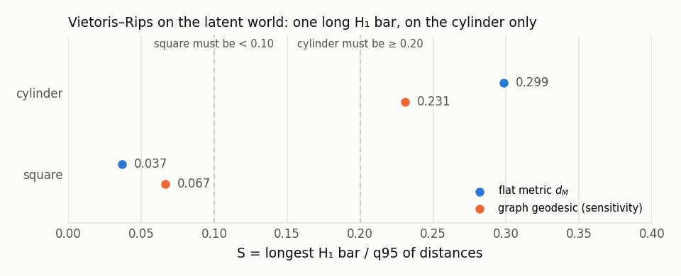

# E0: ground-truth topology and PH calibration

| world | graph cycle rank | β₁ (GF(2)) | S, flat d_M | S, graph metric |
|---|---|---|---|---|
| square | 121 | 0 | 0.037 | 0.067 |
| cylinder | 133 | 1 | 0.299 | 0.231 |

Gate G-A: **pass**
- betti_correct_both_worlds: True (threshold True) -> pass
- S_cylinder_long_bar: 0.298511 (threshold 0.2) -> pass
- S_square_no_long_bar: 0.037048 (threshold 0.1) -> pass
- synthetic_circle_vs_disk: 20 (threshold 19) -> pass

Synthetic calibration (M=512, R^128): mean S circle 0.460, max S disk 0.045.

