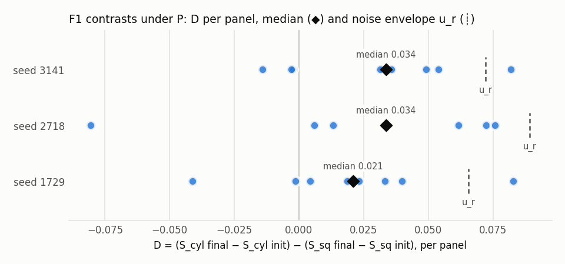

# E3 (P): F1 under condition P (S5)

**F1 verdict: REJECTED** (replicate 0: cond1 failed (6 positive panels); replicate 0: cond2 failed (median D 0.02095 <= u 0.06564); replicate 1: cond2 failed (median D 0.03367 <= u 0.08927); replicate 2: cond1 failed (5 positive panels); replicate 2: cond2 failed (median D 0.03363 <= u 0.07218))

Missing replicates (not run): none

## Prediction vs oracle (p = 32, test panels)

| run | captured | regret (nats) | G_C (nats) | dev CE, final | learning gate | wall (min) |
|---|---|---|---|---|---|---|
| cylinder-P-1729 | 0.878 | 0.0325 | 0.2658 | 2.9679 | pass | 13.8 |
| cylinder-P-2718 | 0.874 | 0.0335 | 0.2658 | 2.9627 | pass | 14.4 |
| cylinder-P-3141 | 0.875 | 0.0332 | 0.2658 | 2.9653 | pass | 14.0 |
| square-P-1729 | 0.914 | 0.0279 | 0.3248 | 2.8399 | pass | 13.1 |
| square-P-2718 | 0.914 | 0.0279 | 0.3248 | 2.8422 | pass | 16.0 |
| square-P-3141 | 0.914 | 0.0280 | 0.3248 | 2.8445 | pass | 15.6 |

## F1 contrasts (median S over 8 panels; RESEARCH_SUMMARY §7.4)

| replicate | S cyl init | S cyl final | S sq init | S sq final | panels D > 0 | median D | u_r | median D > u_r |
|---|---|---|---|---|---|---|---|---|
| 1729 | 0.049 | 0.172 | 0.054 | 0.169 | 6/8 | 0.0209 | 0.0656 | no |
| 2718 | 0.065 | 0.174 | 0.058 | 0.136 | 7/8 | 0.0337 | 0.0893 | no |
| 3141 | 0.063 | 0.181 | 0.060 | 0.153 | 5/8 | 0.0336 | 0.0722 | no |

## Representation baselines (D-028: baseline in place of the final checkpoint)

| replicate | model median D | R1: median D (panels > 0, ratio) | R2: median D (panels > 0, ratio) | R3: median D (panels > 0, ratio) |
|---|---|---|---|---|
| 1729 | 0.0209 | -0.0351 (0, -1.68) | 0.0047 (6, 0.22) | -0.0002 (4, -0.01) |
| 2718 | 0.0337 | 0.0084 (7, 0.25) | -0.0027 (2, -0.08) | -0.0134 (2, -0.40) |
| 3141 | 0.0336 | 0.0073 (6, 0.22) | -0.0007 (4, -0.02) | -0.0074 (3, -0.22) |

## H2: Δgeom = ρ(d_A, d_B32) − ρ(d_A, d_B1) (D-031 for same-w₃₂ pairs)

| replicate | world | median Δgeom, all pairs | panels > 0 | median Δgeom, same w₃₂ | panels > 0 (of ok) |
|---|---|---|---|---|---|
| 1729 | cylinder | 0.036 | 8/8 | 0.799 | 8/8 |
| 1729 | square | 0.061 | 8/8 | 0.837 | 8/8 |
| 2718 | cylinder | 0.057 | 8/8 | 0.805 | 8/8 |
| 2718 | square | 0.088 | 8/8 | 0.840 | 8/8 |
| 3141 | cylinder | 0.040 | 8/8 | 0.817 | 8/8 |
| 3141 | square | 0.072 | 8/8 | 0.837 | 8/8 |

## Gaussian floor (reported, never a threshold; D-005)

| replicate | world | S final, panel 1 | iso floor mean / q95 | cov floor mean / q95 |
|---|---|---|---|---|
| 1729 | cylinder | 0.172 | 0.057 / 0.063 | 0.083 / 0.096 |
| 1729 | square | 0.173 | 0.057 / 0.066 | 0.082 / 0.094 |
| 2718 | cylinder | 0.178 | 0.057 / 0.064 | 0.081 / 0.093 |
| 2718 | square | 0.220 | 0.057 / 0.064 | 0.080 / 0.094 |
| 3141 | cylinder | 0.225 | 0.056 / 0.063 | 0.080 / 0.090 |
| 3141 | square | 0.177 | 0.058 / 0.068 | 0.084 / 0.099 |

Gate G-F: **pass**
- learning_gate_replicate_0: True (threshold True) -> pass
- learning_gate_replicate_1: True (threshold True) -> pass
- learning_gate_replicate_2: True (threshold True) -> pass

## X4 (SECONDARY; PREREGISTRATION_X4.md): representation vs readout geometry

Secondary analyses; they never replace the F1 verdict above.

Blinding: Blind to owner and to the planning conductor; a prior conductor session that ended before this plan may have seen S4 console output; no repo changes after the S4 analysis (last commit a4f7844, 11:50).

Missing runs (not run): none

Views: V0 = resid_post_3, raw (primary metric); V1 = LN-gauge-free u; V2 = ln_final_out; V3 = readout-visible P_A u; V4 = readout-null u − P_A u; V5 = softmax(logits), Hellinger.

### F1 rule under each view (median S over 8 panels)

| view | replicate | S cyl init | S cyl final | S sq init | S sq final | panels D > 0 | median D | u_r | F1-rule under view |
|---|---|---|---|---|---|---|---|---|---|
| V0 | 1729 | 0.049 | 0.172 | 0.054 | 0.169 | 6/8 | 0.0209 | 0.0656 | REJECTED |
| V0 | 2718 | 0.065 | 0.174 | 0.058 | 0.136 | 7/8 | 0.0337 | 0.0893 | REJECTED |
| V0 | 3141 | 0.063 | 0.181 | 0.060 | 0.153 | 5/8 | 0.0336 | 0.0722 | REJECTED |
| V1 | 1729 | 0.048 | 0.237 | 0.048 | 0.215 | 6/8 | 0.0162 | 0.0611 | REJECTED |
| V1 | 2718 | 0.054 | 0.234 | 0.071 | 0.208 | 8/8 | 0.0462 | 0.0503 | REJECTED |
| V1 | 3141 | 0.049 | 0.214 | 0.059 | 0.218 | 5/8 | 0.0095 | 0.0441 | REJECTED |
| V2 | 1729 | 0.048 | 0.233 | 0.048 | 0.215 | 6/8 | 0.0164 | 0.0588 | REJECTED |
| V2 | 2718 | 0.054 | 0.234 | 0.071 | 0.207 | 8/8 | 0.0426 | 0.0514 | REJECTED |
| V2 | 3141 | 0.049 | 0.218 | 0.059 | 0.215 | 6/8 | 0.0128 | 0.0426 | REJECTED |
| V3 | 1729 | 0.054 | 0.218 | 0.070 | 0.206 | 6/8 | 0.0333 | 0.0720 | REJECTED |
| V3 | 2718 | 0.066 | 0.244 | 0.074 | 0.213 | 5/8 | 0.0350 | 0.0733 | REJECTED |
| V3 | 3141 | 0.064 | 0.221 | 0.072 | 0.230 | 6/8 | 0.0047 | 0.0685 | REJECTED |
| V4 | 1729 | 0.069 | 0.097 | 0.062 | 0.089 | 4/8 | -0.0002 | 0.0304 | REJECTED |
| V4 | 2718 | 0.051 | 0.104 | 0.057 | 0.103 | 6/8 | 0.0165 | 0.0405 | REJECTED |
| V4 | 3141 | 0.052 | 0.096 | 0.061 | 0.100 | 5/8 | 0.0121 | 0.0394 | REJECTED |
| V5 | 1729 | 0.054 | 0.197 | 0.071 | 0.265 | 0/8 | -0.0345 | 0.0975 | REJECTED |
| V5 | 2718 | 0.094 | 0.207 | 0.069 | 0.257 | 0/8 | -0.0630 | 0.0790 | REJECTED |
| V5 | 3141 | 0.072 | 0.202 | 0.077 | 0.236 | 2/8 | -0.0240 | 0.0899 | REJECTED |

### Δgeom per view (checkpoint final)

| view | median Δgeom, all pairs | panels > 0 | median Δgeom, same w₃₂ | panels > 0 (of ok) |
|---|---|---|---|---|
| V0 | 0.058 | 48/48 | 0.819 | 48/48 |
| V1 | 0.032 | 43/48 | 0.832 | 48/48 |
| V2 | 0.027 | 45/48 | 0.832 | 48/48 |
| V3 | 0.034 | 47/48 | 0.829 | 48/48 |
| V4 | 0.009 | 30/48 | 0.508 | 48/48 |
| V5 | 0.090 | 28/48 | 0.810 | 48/48 |

Pipeline checks (max over runs and checkpoints): ln_reconstruction_max_abs = 0.0000013; logits_from_U_max_abs = 0.0000049; logits_from_visible_max_abs = 0.0000049.

### X4-a (gauge robustness)

X4-a (gauge robustness): the verdict under V1 equals the verdict under V0. If V0 is supported but V1 is not, the primary signal lives in readout-invisible gauge directions: report it as a caveat on F1, not as a refutation.

Result: V0 REJECTED, V1 REJECTED; equal: yes; caveat case (V0 supported, V1 not): no.

### X4-b (functional geometry)

X4-b (functional geometry): under O, the verdict under V5 is SUPPORTED (expected because oracle future1 separates the worlds 8/8 and the models pass the learning gate). Positive control: median over panels of ρ_s(d_V5, d_future1) ≥ 0.9 in every replicate; if the control fails, X4-b is INCONCLUSIVE (pipeline or model issue).

Positive control, median over panels of ρ_s(d_V5, d_future1) per run: cylinder-1729: 0.972, cylinder-2718: 0.972, cylinder-3141: 0.971, square-1729: 0.976, square-2718: 0.975, square-3141: 0.976; passed: yes.

Result: X4-b REJECTED.

Under P the X4-b expectation (stated for O) does not apply: the oracle future1 does not separate the worlds under P (1/8 panels, PREREGISTRATION §3). The V5 verdict under P is descriptive; the positive control is reported as is.

### X4-c (where the structure lives)

X4-c (where the structure lives): two-sided, descriptive. Report median_i D under V3 and under V4, and their ratio, per replicate. Interpretation fixed in advance:

median_i D per replicate: 1729: V3 0.0333, V4 -0.0002, ratio -168.52; 2718: V3 0.0350, V4 0.0165, ratio 2.12; 3141: V3 0.0047, V4 0.0121, ratio 0.39.

Category: neither. Pre-registered interpretation: both / neither → reported as such.

### X4-d (same-last-symbol H2 baseline)

X4-d (same-last-symbol H2 baseline): within pairs with equal w32, compare ρ_s(d_A, d_B32) for the model (V0 and V1) against R2 and R3 (R1 is constant on these pairs and excluded). Supported iff the model value exceeds max(R2, R3) in all 3 replicates and ≥ 7/8 panels.

- A = V0: panels passing per run cylinder-1729: 8, cylinder-2718: 8, cylinder-3141: 8, square-1729: 8, square-2718: 8, square-3141: 8; X4-d SUPPORTED
- A = V1: panels passing per run cylinder-1729: 8, cylinder-2718: 8, cylinder-3141: 8, square-1729: 8, square-2718: 8, square-3141: 8; X4-d SUPPORTED

### H3′ (approved at H3, D-037; decided under P only)

H3′ (requires owner approval at checkpoint H3; until approved, report only as descriptive): under P, at checkpoint 5000, ρ_s(d_A, d_B32) on all pairs (A = V0 and, separately, V1) exceeds both its checkpoint-0 value and max(R2, R3) in all 3 replicates and ≥ 7/8 panels. Under O the same measure is reported for comparison. H3 as registered stays one-sided.

Condition P: decision rule (approved at H3, D-037; D-039 operational rule).
- A = V0: panels passing per run cylinder-1729: 8, cylinder-2718: 8, cylinder-3141: 8, square-1729: 8, square-2718: 8, square-3141: 8; rule outcome SUPPORTED
- A = V1: panels passing per run cylinder-1729: 8, cylinder-2718: 8, cylinder-3141: 8, square-1729: 8, square-2718: 8, square-3141: 8; rule outcome SUPPORTED

### Interpretation caveats (addendum D-040, fixed before results)

The analyses, thresholds and verdict rules above are unchanged. These caveats qualify how the pre-registered interpretations are read; any new analysis they suggest is a separately labelled follow-up, not part of X4.
1. LayerNorm gauge (V1): `ln_gauge_free` is exactly invariant to per-history shifts along the all-ones vector; with eps = 1e-5 it is not exactly invariant to positive rescaling (exact identity: U_eps(αz) = U_{eps/α²}(z)). The V1 definition is unchanged.
2. Readout split (X4-c): V3 is the logit-readout-visible subspace, not necessarily the functionally necessary subspace. Softmax is also invariant to constant logit shifts, so up to one further direction inside range(A) does not affect the predictive distribution. V4 is logit-readout-null. H1 structure in V3 is not evidence of causal predictive use; that needs interventions.
3. Functional geometry (X4-b): the oracle's future1 separating the worlds does not mathematically guarantee that the trained model's predictive cloud has the same topology (passing the learning gate bounds an average KL, not H1 persistence). X4-b is a falsifiable empirical hypothesis; "expected" above is a prediction, not a theorem.
4. Gauge robustness (X4-a): a verdict difference between V0 and V1 establishes sensitivity to normalisation (per-history centring and rescaling), not that the whole signal lies in the mean-shift gauge direction.

