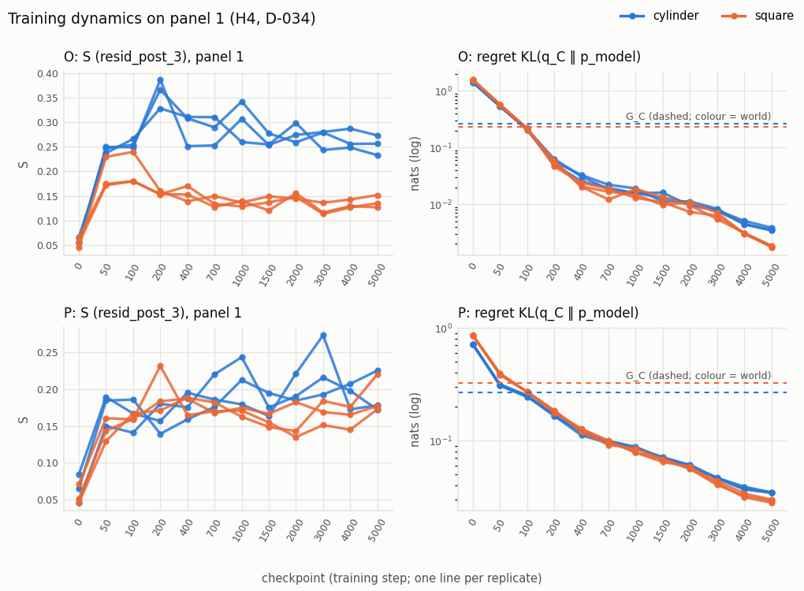
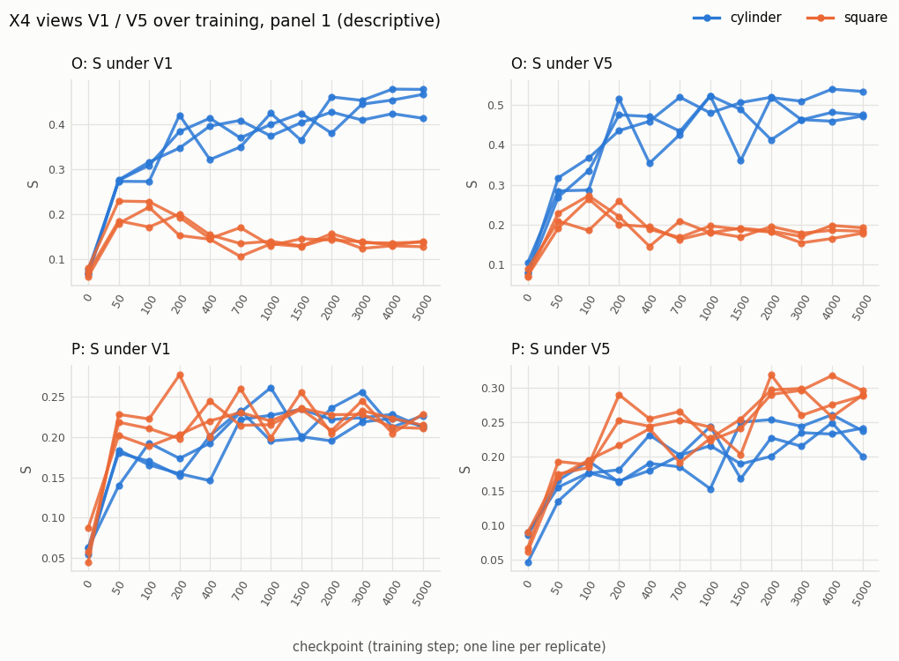

# E3: condition P (S5), training dynamics (S6), X4 under O and P

Primary hypotheses (PREREGISTRATION.md) come first; H3′ is a decision rule approved at H3 (D-037); X4 items are secondary; S6 extras are descriptive.

## Primary: H3 (F1 rule under P)

| H3 | Under the axis-permuted emission P, $D_r>0$ still holds, so the structure is learned from dynamics and not only from emission geometry | F1 rule applied to P | The rule fails under P although the learning gate passed |

**F1 rule under P: REJECTED** (replicate 0: cond1 failed (6 positive panels); replicate 0: cond2 failed (median D 0.02095 <= u 0.06564); replicate 1: cond2 failed (median D 0.03367 <= u 0.08927); replicate 2: cond1 failed (5 positive panels); replicate 2: cond2 failed (median D 0.03363 <= u 0.07218))

The F1 rule fails under P although every learning gate passed. Pre-registered one-sided reading (PREREGISTRATION §3, conductor note below): this outcome is expected even for the ideal predictor and is NOT read as evidence that the structure comes from emission geometry; H3 is uninformative in this direction.

**Which hypotheses are decidable (conductor note):** Under O every unlearned space separates the worlds in 8/8 panels, at 3-8x the Gaussian floor (belief32 median S 0.671 vs 0.321), so F1 and H2 are decidable; b32 and b1 geometries differ (cylinder 0.671 vs 0.324). The E1 stop path is not triggered. Under P the exact belief b32 shows no reliable world difference (5/8 panels; 0.323 vs 0.310) and the future spaces reverse (1/8, 2/8), while b1 and the emission field are permutation-invariant clouds and keep their O values. Hence H3 is decidable one-sidedly only: D_r > 0 under P would be informative, but a failure under P is expected even for the ideal predictor and will NOT be read as evidence that structure comes from emission geometry.

Full S5 tables (prediction vs oracle, F1 contrasts, baselines, Δgeom, Gaussian floor, G-F, X4 under P): [condition_P.md](condition_P.md).

## Primary: H4 (training dynamics, cylinder runs under O)

| H4 | $S$ rises only after the model starts using history (regret drops below $G_C$) | curves over 12 checkpoints; checkpoint-order permutation null | $S$ rises before history use |

Rule (fixed before any S4 result):

2026-10-13 | D-034 | H4 rule fixed before any S4 result: per run, on panel 1 at the 12 checkpoints, t_h = first checkpoint with regret < G_C and t_s = first checkpoint with S_t − S_0 > u_r (the replicate's F1 noise envelope); a cylinder run is consistent if t_s ≥ t_h (same checkpoint counts as consistent: grid resolution), violated if t_s < t_h, 'no rise' if S never exceeds S_0 + u_r. H4 supported iff all 3 cylinder runs under O are consistent; rejected iff any is violated with all learning gates passed; else inconclusive. Square runs and P are reported descriptively. Checkpoint-order null (1000 perms, SeedTree(0)) and the layer sweep (F1 contrast per hook + concat, 8 panels) are descriptive, never decisive | RESEARCH_SUMMARY §2 H4 names the comparison but no threshold or noise scale | RESEARCH_SUMMARY §2, §7.7; STAGES S6

**H4 under O: REJECTED** (S rose before history use in a cylinder run)

H4 rejected: in at least one cylinder run under O, S rose before history use, with every learning gate passed.

| run | G_C | u_r | t_history | t_rise (V0) | D-034 class | t_rise V1 | t_rise V5 | order-null share first third | order-null p |
|---|---|---|---|---|---|---|---|---|---|
| cylinder-1729 | 0.2649 | 0.0966 | 100 | 50 | violated | 50 | 50 | 0.651 | 0.121 |
| square-1729 | 0.2360 | 0.0966 | 100 | 50 | violated | never | 50 | 0.492 | 0.209 |
| cylinder-2718 | 0.2649 | 0.0839 | 100 | 50 | violated | 50 | 50 | 0.750 | 0.069 |
| square-2718 | 0.2360 | 0.0839 | 100 | 50 | violated | never | 50 | 0.819 | 0.016 |
| cylinder-3141 | 0.2649 | 0.0842 | 100 | 50 | violated | 50 | 50 | 0.615 | 0.183 |
| square-3141 | 0.2360 | 0.0842 | 100 | 50 | violated | never | 200 | 0.590 | 0.118 |

Under P (descriptive only, D-034): rule outcome REJECTED (S rose before history use in a cylinder run).

| run | G_C | u_r | t_history | t_rise (V0) | D-034 class | t_rise V1 | t_rise V5 | order-null share first third | order-null p |
|---|---|---|---|---|---|---|---|---|---|
| cylinder-1729 | 0.2658 | 0.0656 | 100 | 50 | violated | 50 | 100 | 0.415 | 0.330 |
| square-1729 | 0.3248 | 0.0656 | 100 | 50 | violated | 50 | 50 | 0.728 | 0.058 |
| cylinder-2718 | 0.2658 | 0.0893 | 100 | 50 | violated | 50 | 50 | 0.417 | 0.391 |
| square-2718 | 0.3248 | 0.0893 | 100 | 100 | consistent | 50 | 50 | 0.506 | 0.275 |
| cylinder-3141 | 0.2658 | 0.0722 | 100 | 50 | violated | 50 | 400 | 0.605 | 0.149 |
| square-3141 | 0.3248 | 0.0722 | 100 | 50 | violated | 50 | 50 | 0.598 | 0.294 |

t_history = first checkpoint with regret < G_C; t_rise = first checkpoint with S_t − S_0 > u_r. The V1 / V5 columns use the same rule with that view's u_r from X4 (D-044, descriptive). The checkpoint-order null is descriptive, never decisive.

## Decision rule H3′ (approved at H3, D-037)

H3′ (requires owner approval at checkpoint H3; until approved, report only as descriptive): under P, at checkpoint 5000, ρ_s(d_A, d_B32) on all pairs (A = V0 and, separately, V1) exceeds both its checkpoint-0 value and max(R2, R3) in all 3 replicates and ≥ 7/8 panels. Under O the same measure is reported for comparison. H3 as registered stays one-sided.

- P (decision), A = V0: panels passing per run cylinder-1729: 8, cylinder-2718: 8, cylinder-3141: 8, square-1729: 8, square-2718: 8, square-3141: 8; **SUPPORTED**
- O (comparison only), A = V0: panels passing per run cylinder-1729: 8, cylinder-2718: 8, cylinder-3141: 8, square-1729: 8, square-2718: 8, square-3141: 8; **SUPPORTED**
- P (decision), A = V1: panels passing per run cylinder-1729: 8, cylinder-2718: 8, cylinder-3141: 8, square-1729: 8, square-2718: 8, square-3141: 8; **SUPPORTED**
- O (comparison only), A = V1: panels passing per run cylinder-1729: 8, cylinder-2718: 8, cylinder-3141: 8, square-1729: 8, square-2718: 8, square-3141: 8; **SUPPORTED**

## Secondary: X4 under O and P (PREREGISTRATION_X4.md)

| item | O (S4) | P (S5) |
|---|---|---|
| F1 rule under V0 | SUPPORTED | REJECTED |
| F1 rule under V1 | SUPPORTED | REJECTED |
| F1 rule under V2 | SUPPORTED | REJECTED |
| F1 rule under V3 | SUPPORTED | REJECTED |
| F1 rule under V4 | SUPPORTED | REJECTED |
| F1 rule under V5 | SUPPORTED | REJECTED |
| X4-b (V5 functional geometry) | SUPPORTED | REJECTED |
| X4-d, A = V0 | SUPPORTED | SUPPORTED |
| X4-d, A = V1 | SUPPORTED | SUPPORTED |
| H3′ rule, A = V0 | SUPPORTED | SUPPORTED |
| H3′ rule, A = V1 | SUPPORTED | SUPPORTED |
| X4-a verdicts V0 = V1 | yes | yes |
| X4-b positive control passed | yes | yes |
| X4-c category | both | neither |

X4-b's expectation is pre-registered for O only; under P it is descriptive. Per-view tables for P: [condition_P.md](condition_P.md); for O: [../E2/summary.md](../E2/summary.md).

## Comparison with E2 (O) — F1 contrast and baselines

| replicate | condition | panels D > 0 | median D | u_r | R1 median D (ratio) | R2 ratio | R3 ratio |
|---|---|---|---|---|---|---|---|
| 1729 | O | 8/8 | 0.1582 | 0.0966 | 0.1402 (0.89) | 0.17 | 0.02 |
| 1729 | P | 6/8 | 0.0209 | 0.0656 | -0.0351 (-1.68) | 0.22 | -0.01 |
| 2718 | O | 8/8 | 0.1762 | 0.0839 | 0.0828 (0.47) | 0.20 | 0.10 |
| 2718 | P | 7/8 | 0.0337 | 0.0893 | 0.0084 (0.25) | -0.08 | -0.40 |
| 3141 | O | 8/8 | 0.1726 | 0.0842 | 0.0935 (0.54) | 0.19 | 0.08 |
| 3141 | P | 5/8 | 0.0336 | 0.0722 | 0.0073 (0.22) | -0.02 | -0.22 |

| condition | world | median Δgeom, all pairs (panels > 0) | median Δgeom, same w₃₂ (panels > 0 of ok) |
|---|---|---|---|
| O | cylinder | 0.125 (24/24) | 0.938 (24/24) |
| O | square | 0.088 (24/24) | 0.978 (24/24) |
| P | cylinder | 0.041 (24/24) | 0.809 (24/24) |
| P | square | 0.072 (24/24) | 0.839 (24/24) |

## Layer sweep (descriptive, RESEARCH_SUMMARY §7.7)

| hook | condition | median D per replicate | panels D > 0 | u_r per replicate | replicates with median D > u_r |
|---|---|---|---|---|---|
| embed | O | 0.110 / 0.104 / 0.105 | 8/8 / 8/8 / 8/8 | 0.000 / 0.000 / 0.000 | 3/3 |
| embed | P | -0.040 / 0.025 / -0.003 | 0/8 / 8/8 / 0/8 | 0.000 / 0.000 / 0.000 | 1/3 |
| resid_post_0 | O | 0.130 / 0.153 / 0.161 | 8/8 / 8/8 / 8/8 | 0.089 / 0.119 / 0.112 | 3/3 |
| resid_post_0 | P | -0.003 / 0.008 / 0.003 | 4/8 / 5/8 / 4/8 | 0.040 / 0.047 / 0.056 | 0/3 |
| resid_post_1 | O | 0.148 / 0.184 / 0.162 | 8/8 / 8/8 / 8/8 | 0.123 / 0.116 / 0.119 | 3/3 |
| resid_post_1 | P | 0.013 / 0.002 / -0.006 | 5/8 / 5/8 / 2/8 | 0.043 / 0.040 / 0.044 | 0/3 |
| resid_post_2 | O | 0.175 / 0.186 / 0.172 | 8/8 / 8/8 / 8/8 | 0.103 / 0.096 / 0.106 | 3/3 |
| resid_post_2 | P | -0.004 / 0.044 / 0.005 | 3/8 / 7/8 / 5/8 | 0.065 / 0.069 / 0.061 | 0/3 |
| resid_post_3 | O | 0.158 / 0.176 / 0.173 | 8/8 / 8/8 / 8/8 | 0.097 / 0.084 / 0.084 | 3/3 |
| resid_post_3 | P | 0.021 / 0.034 / 0.034 | 6/8 / 7/8 / 5/8 | 0.066 / 0.089 / 0.072 | 0/3 |
| ln_final_out | O | 0.283 / 0.290 / 0.273 | 8/8 / 8/8 / 8/8 | 0.158 / 0.153 / 0.131 | 3/3 |
| ln_final_out | P | 0.016 / 0.043 / 0.013 | 6/8 / 8/8 / 6/8 | 0.059 / 0.051 / 0.043 | 0/3 |
| concat | O | 0.166 / 0.188 / 0.170 | 8/8 / 8/8 / 8/8 | 0.110 / 0.106 / 0.104 | 3/3 |
| concat | P | 0.008 / 0.046 / 0.010 | 6/8 / 8/8 / 6/8 | 0.055 / 0.060 / 0.057 | 0/3 |

embed: at p = 32 the embedding depends on w₃₂ only (at most 36 distinct points, the same in every panel), so its S is panel-independent and u_r = 0 by construction.

Post hoc reading (not pre-registered; written after this summary): [exploratory.md](exploratory.md).

**Not run:** S7 (U and extra N controls, probes, sensitivity, circular coordinates), S8 (clean rerun), X4-causal and other extensions.

