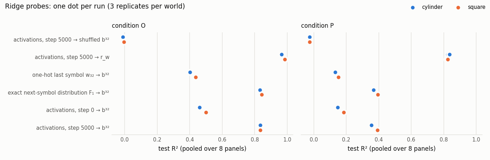
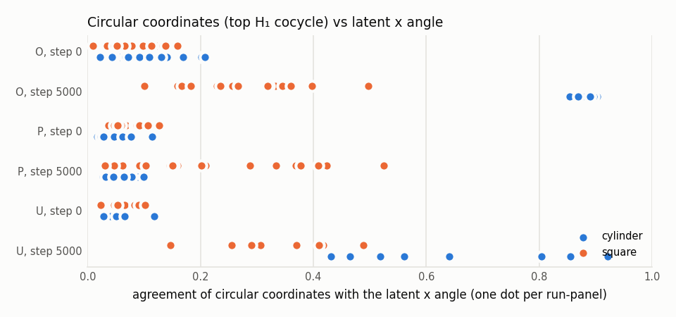

# E4: controls, probes, circular coordinates, sensitivity (S7) and clean rerun (S8)

Primary hypotheses (PREREGISTRATION.md) were decided at E2/E3 and are repeated unchanged. H3′ is a decision rule approved at H3 (D-037). X4 items are secondary. Everything from S7 is either descriptive or a robustness check of a primary verdict, with its details fixed before any S7 result existed (D-047). None of it changes a primary verdict.

## 1. Primary hypotheses (unchanged since E2/E3)

| hypothesis | decided at | verdict | key values |
|---|---|---|---|
| F1 (O, primary) | E2 | SUPPORTED | median D / u_r per replicate: 0.158/0.097, 0.176/0.084, 0.173/0.084 |
| H2 (O) | E2 | sign-consistent (see values) | Δgeom > 0 in 48/48 run-panels (all pairs), 48/48 (same w₃₂) |
| H3 (F1 rule under P) | E3 | REJECTED: uninformative by design | median D / u_r: 0.021/0.066, 0.034/0.089, 0.034/0.072 |
| H4 (timing, cylinder runs under O) | E3 | REJECTED | S rose before history use in a cylinder run |
| H3′ (decision rule under P, D-037) | E3 | SUPPORTED | – |
| H0 (N models) | E2 + S7 | pass (S4), 2/2 S7 N runs pass | NLL at p = 32 not below H(W) beyond the bootstrap CI |

The F1 rule fails under P although every learning gate passed. Pre-registered one-sided reading (PREREGISTRATION §3, conductor note below): this outcome is expected even for the ideal predictor and is NOT read as evidence that the structure comes from emission geometry; H3 is uninformative in this direction.

H4 rejected: in at least one cylinder run under O, S rose before history use, with every learning gate passed.

## 2. Secondary: X4 under O and P (PREREGISTRATION_X4.md)

| item | O (S4) | P (S5) |
|---|---|---|
| F1 rule under V0 | SUPPORTED | REJECTED |
| F1 rule under V1 | SUPPORTED | REJECTED |
| F1 rule under V2 | SUPPORTED | REJECTED |
| F1 rule under V3 | SUPPORTED | REJECTED |
| F1 rule under V4 | SUPPORTED | REJECTED |
| F1 rule under V5 | SUPPORTED | REJECTED |
| X4-b (V5 functional geometry) | SUPPORTED | REJECTED |
| X4-d, A = V0 | SUPPORTED | SUPPORTED |
| X4-d, A = V1 | SUPPORTED | SUPPORTED |
| H3′ rule, A = V0 | SUPPORTED | SUPPORTED |
| H3′ rule, A = V1 | SUPPORTED | SUPPORTED |
| X4-a verdicts V0 = V1 | yes | yes |
| X4-b positive control passed | yes | yes |
| X4-c category | both | neither |

## 3. S7 controls: U and extra N runs

Under U the last symbol reveals the state, so G_C = 0 and the learning gate is undefined by construction. The U sanity check compares regret with the gain G_U = KL(q_C ‖ πE) of the exact predictor over the unigram marginal (D-047, descriptive). Its belief cloud is the set of simplex vertices, so U is not a PH positive control (RESEARCH_PLAN §3.3). The PH of the U models is descriptive.

| run | V | regret (nats) | gain over the unigram G_U (U) / G_C | captured (captured_U for U) | learning gate | H0: NLL p=32 vs H(W) − CI/2 | wall (min) |
|---|---|---|---|---|---|---|---|
| any-N-2718 | 36 | 0.0000 | 0.0000 | n/a (G_C = 0) | n/a (G_C = 0) | 3.5835 vs 3.5833: pass | 17.2 |
| any-N-3141 | 36 | 0.0000 | 0.0000 | n/a (G_C = 0) | n/a (G_C = 0) | 3.5835 vs 3.5833: pass | 18.8 |
| cylinder-U-1729 | 144 | 0.0050 | 3.4069 | 0.999 | n/a (G_C = 0) | n/a | 21.5 |
| square-U-1729 | 144 | 0.0051 | 3.4558 | 0.999 | n/a (G_C = 0) | n/a | 14.5 |
| any-N-1729 (S4) | 36 |  |  |  | n/a (G_C = 0) | 3.5835 vs 3.5834: pass |  |

| run | median S, step 0 | median S, step final | panels |
|---|---|---|---|
| any-N-1729 | 0.068 | 0.031 | 8 |
| any-N-2718 | 0.072 | 0.002 | 8 |
| any-N-3141 | 0.063 | 0.077 | 8 |
| cylinder-U-1729 | 0.069 | 0.215 | 8 |
| square-U-1729 | 0.060 | 0.147 | 8 |

U pair, cylinder − square contrast D per panel (one replicate, descriptive): median 0.054, D > 0 in 8/8 panels.

## 4. S7 probes (descriptive)

Fit on dev panels 1–6, λ chosen on dev panels 7–8, scored once on the 8 test panels. One-hot w₃₂ is the best affine decoder from the last symbol, so it bounds every decoder that uses r_w alone. F₁ = b³²TE is the exact next-symbol distribution: decoding b³² from it measures how much of the belief is linearly recoverable from what the next-token objective requires.

| probe (features → target) | O: median test R² (range over 6 runs) | P: median test R² (range) |
|---|---|---|
| activations, step 5000 → b³² (main) | 0.829 (0.822–0.835) | 0.378 (0.355–0.398) |
| activations, step 0 → b³² | 0.483 (0.458–0.508) | 0.167 (0.148–0.185) |
| exact next-symbol distribution F₁ → b³² | 0.838 (0.832–0.843) | 0.382 (0.367–0.396) |
| one-hot last symbol w₃₂ → b³² | 0.421 (0.401–0.438) | 0.144 (0.133–0.153) |
| activations, step 5000 → r_w (last-symbol posterior) | 0.974 (0.965–0.985) | 0.825 (0.817–0.835) |
| activations, step 5000 → shuffled b³² (label control) | -0.010 (-0.018–-0.005) | -0.027 (-0.028–-0.025) |

λ chosen on dev panels 7–8 for the main probe: O: 0.001; P: 1.000 (grid 1e-3 … 10).
Predeclared descriptive pattern (D-047), R²(A5000 → b³²) above all of A0, one-hot and F₁: O: 1/6 runs; P: 1/6 runs.

## 5. S7 circular coordinates (descriptive, privileged_eval)

Agreement A = max(|mean e^{i(φ−θ)}|, |mean e^{i(φ+θ)}|) ∈ [0, 1], with φ the circular coordinate from the top H₁ cocycle (F₄₇, mid-lifetime) and θ = 2πx(z₃₂)/12. The null permutes θ over the 512 histories of a panel (1000 draws). These values use the latent state (privileged_eval) and are descriptive. On the square, x is not periodic, so the same statistic serves as a comparison.

| condition | world | step | median agreement with x angle (per-run medians) | panels above null q95 | panels with an H₁ class | control: y angle | oracle b³² vs x |
|---|---|---|---|---|---|---|---|
| O | cylinder | 0 | 0.069 (0.058, 0.120, 0.069) | 15/24 | 24/24 | 0.077 | 0.915 |
| O | cylinder | 5000 | 0.891 (0.891, 0.892, 0.884) | 24/24 | 24/24 | 0.097 | 0.915 |
| O | square | 0 | 0.078 (0.078, 0.060, 0.082) | 14/24 | 24/24 | 0.084 | 0.921 |
| O | square | 5000 | 0.256 (0.298, 0.256, 0.209) | 24/24 | 24/24 | 0.271 | 0.921 |
| P | cylinder | 0 | 0.052 (0.045, 0.054, 0.052) | 4/24 | 24/24 | 0.064 | 0.819 |
| P | cylinder | 5000 | 0.053 (0.053, 0.049, 0.054) | 9/24 | 24/24 | 0.094 | 0.819 |
| P | square | 0 | 0.068 (0.068, 0.061, 0.089) | 14/24 | 24/24 | 0.054 | 0.897 |
| P | square | 5000 | 0.152 (0.179, 0.104, 0.152) | 21/24 | 24/24 | 0.093 | 0.897 |
| U | cylinder | 0 | 0.060 (0.060) | 6/8 | 8/8 | 0.055 | 1.000 |
| U | cylinder | 5000 | 0.601 (0.601) | 8/8 | 8/8 | 0.297 | 1.000 |
| U | square | 0 | 0.059 (0.059) | 5/8 | 8/8 | 0.048 | 1.000 |
| U | square | 5000 | 0.338 (0.338) | 8/8 | 8/8 | 0.361 | 1.000 |

## 6. S7 sensitivity (robustness checks, one factor at a time)

One factor at a time: chord = Euclidean distance of normalised activations; pca32 = PCA-32 fitted on the same run's dev activations at the same checkpoint; M256 = the first 256 histories of each panel; sqrt_js = √JSD for belief clouds (it changes Δgeom and H3′ only). Verdicts are robustness checks and never replace the primary verdict. Under P, the F1 rule stays one-sided (PREREGISTRATION §3).

| variant | condition | F1 rule (median D per replicate / u_r) | H3′ rule | Δgeom > 0 (fraction of run-panels) |
|---|---|---|---|---|
| primary (S4/S5, X4) | O | SUPPORTED (0.158/0.097, 0.176/0.084, 0.173/0.084) | SUPPORTED | 1.00 |
| primary (S4/S5, X4) | P | REJECTED (0.021/0.066, 0.034/0.089, 0.034/0.072) | SUPPORTED | 1.00 |
| chord | O | SUPPORTED (0.293/0.161, 0.300/0.157, 0.279/0.132) | SUPPORTED | 1.00 |
| chord | P | REJECTED (0.018/0.061, 0.041/0.050, 0.009/0.044) | SUPPORTED | 0.90 |
| pca32 | O | SUPPORTED (0.158/0.097, 0.177/0.084, 0.173/0.084) | SUPPORTED | 1.00 |
| pca32 | P | REJECTED (0.029/0.067, 0.037/0.092, 0.030/0.074) | SUPPORTED | 1.00 |
| M256 | O | SUPPORTED (0.173/0.071, 0.173/0.066, 0.163/0.090) | SUPPORTED | 1.00 |
| M256 | P | REJECTED (0.014/0.073, 0.010/0.106, 0.011/0.061) | SUPPORTED | 1.00 |
| sqrt_js | O | unchanged (activation S not affected) | SUPPORTED | 1.00 |
| sqrt_js | P | unchanged (activation S not affected) | SUPPORTED | 0.71 |

Gate G-G: **pass**
- run_documented_cylinder-U-1729: 1 -> pass
- run_documented_square-U-1729: 1 -> pass
- run_documented_any-N-2718: 1 -> pass
- run_documented_any-N-3141: 1 -> pass
- analysis_documented_dev_extract: 1 -> pass
- analysis_documented_controls: 1 -> pass
- analysis_documented_probes: 1 -> pass
- analysis_documented_circular: 1 -> pass
- analysis_documented_sensitivity: 1 -> pass

## 7. S8 reproducibility

Clean rerun: a fresh clone of the committed HEAD with an empty artifact store, run with the same interpreter and the same locked environment on the same machine. It is not a different machine. Records that embed measured wall time or throughput are compared without those rows (D-048).

| artifact type | in rerun | id found in main store | checksum equal | gate verdict equal |
|---|---|---|---|---|
| ActivationSet | 12 | 12 | 12 | – |
| BaselineOutputs | 36 | 36 | 36 | – |
| Checkpoint | 12 | 12 | 12 | – |
| Diagrams | 4 | 4 | 4 | – |
| EmissionSpec | 44 | 44 | 44 | – |
| EvalSidecar | 48 | 48 | 48 | – |
| GateReport | 6 | – | – | 6 |
| HistoryIndex | 24 | 24 | 24 | – |
| MetricRecords | 4 | 3 | 3 | – |
| ObservationSet | 72 | 72 | 72 | – |
| OracleOutputs | 24 | 24 | 24 | – |
| ProcessDiagnostics | 24 | 24 | 24 | – |
| TransitionSpec | 2 | 2 | 2 | – |
| WorldSpec | 2 | 2 | 2 | – |

Rerun wall time: S0 0.2 min, S1 0.5 min, S2 4.9 min, S3 14.9 min. Environment: HEAD d2f060b3a4f6 | Windows-10-10.0.26200-SP0 | python 3.10.6.
Mismatches: 1 (MetricRecords:d5f25f7e2968a602:missing).

Store integrity: 785/785 artifacts complete with present parents and verified payload checksums; problems: 0.
Report reproduction (E0/E2/E3, every generated file, byte for byte): 9/9 identical.

Gate G-H: **fail**
- rerun_ok: False -> fail
- integrity_ok: True -> pass
- reports_ok: True -> pass
- module_suites: 511 passed, 7 deselected, 1 warning -> pass
- slow_tests: 3 passed, 515 deselected -> pass
- integration_tests: 4 passed -> pass

Interpretation, limitations and post hoc observations, written after these tables: [interpretation.md](interpretation.md).

**Not run:** X4-causal (interventions), X5, X6 and the extensions X1–X3. No claim is made about causal use of the structure or about natural-language LLMs.

